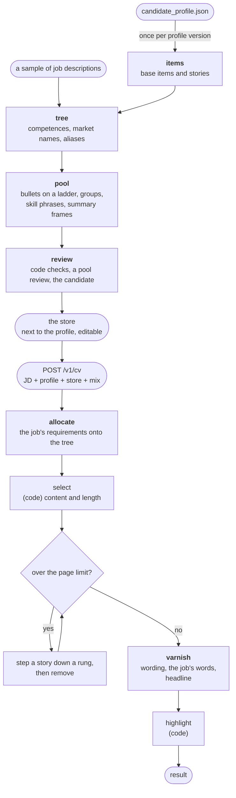

# CV pipeline v2: design

Status: draft, 2026-11-12. The probe of [section 11](#11-plan-of-work) has run: **go**,
on the conditions listed there. Nothing of the build exists yet. This replaces the
draft of 2026-11-10, which compiled the profile into facts and still wrote every CV
with a model; [section 12](#12-alternatives-considered) says what was kept from it.
When v2 ships, it replaces [doc/cv-pipeline.md](doc/cv-pipeline.md), which describes v1.

## Summary

v1 writes every CV from scratch: about 24 model calls and five minutes to
rewrite duties that are, in most CVs, the same duties. The rewriting is where
the errors come from (exaggeration, lost context, garbled sentences), and the
keywords a job description asks for end up crammed into the summary.

v2 moves the writing out of the per-job path. Once per profile, the profile is
compiled into a **store**: a tree of competences named in the market's words,
and a pool of pre-written, reviewed bullets, each tagged with what it proves
and how many lines it takes. For each job description, one model call places
the job's requirements on the tree, and code selects the CV: which stories, at
what length, in which experiences. A model then chooses between stored
wordings, writes the headline and one summary sentence, and edits the job's
own words in where the facts support them.

The balance between what a keyword search wants and what a reader wants is a
set of weights sent with each request, so it can change without a redeploy.

A probe on one real profile and ten held-out job descriptions showed that the
compiled pool can be trusted (4% of bullets wrong at the candidate's first
reading), that the allocation is consistent (two runs share 83% of the placed
importance), that the page budget holds in code (16 of 16 CVs fit at the first
render), and that selection alone does not carry the job's words into the CV:
literal coverage was 35% against v1's 62%, almost all of it the summary. So the
varnish step's edits are part of the design, not a polish.

## 1. Why: what v1 does and what it costs

Measured on 51 CV runs of real applications, their 1,076 rendered bullets, and
2,547 unique job descriptions, all kept in a private data folder; then by the
probe. [Appendix A](#appendix-a-how-the-numbers-were-measured) says how each
number was counted.

| Question | Measured | What it means |
|---|---|---|
| Does v1 tailor the selection? | Of 32 profile duties, 19 are in at least 70% of CVs, 7 are never shown, and 6 really vary. 47 of 51 CVs show the same 3 experiences. | The scoring of every duty against every job buys little selection. |
| Where do the job's keywords end up? | Requirements with one of their keywords present, weighted by importance: 40% in the profile's own text, 58% in the CV, 40% in the CV without its summary. | All of v1's keyword gain is the summary: 743 characters holding 7 of the job's keywords. The rewritten bullets add none. |
| Can lines be budgeted in code? | `lines = ceil(characters / 98)` is exact for 98.8% of bullets. In the probe, a line model in points put 16 of 16 CVs on two pages at the first render. | Yes. The render is a check, not a loop. |
| Are bullet lengths varied? | 94% of bullets are exactly 2 lines, at a median 156 of 196 characters. | No variety, and about a fifth of the bullet area is blank. |
| What does a CV cost? | v1: a median 24 calls, 290 seconds and 221,000 tokens, 63% of them thinking. v2 in the probe: 5 to 6 calls per CV, about 30 once per profile. | |
| Is a job's vocabulary predictable? | 1,796 distinct keywords in 51 jobs; 77% occur in one job only. | A job's wording cannot be written into the bullets in advance. |
| How much of a job can the profile not prove? | v1: about 25% of a job's importance has no duty that proves it. v2: 18% of importance lands on ghost leaves, 0.3% nowhere. | This is the ceiling of any keyword score, and it has to be reported. |
| Is relevance literal? | Of v1's 1,098 strong matches between a duty and a requirement, 17% have one of the requirement's keywords in the duty. | Matching is mostly a judgment of meaning. Keyword matching alone cannot select. |
| Can a one-time compile be trusted? | 4.0% of 176 pool bullets wrong at the candidate's first reading; the review edited 12% of lines. | Yes. Bullets need no validation per job. |
| Does selection carry the job's words? | Literal coverage 35% against v1's 62%; summary alone 19% against 53%. | No. The varnish must put them in. |

## 2. Goals and non-goals

Goals:

1. **Write once, select many times.** The text of a CV is written and reviewed
   once per profile, not once per job.
2. **A tunable balance.** Keyword coverage against context, stories and a
   complete career, as weights in the client's configuration.
3. **No silent gaps.** An experience is left out only when the balance says so,
   and the earliest and the most recent are always shown.
4. **A readable summary.** The job's keywords move to where they cost a reader
   least.
5. **Fewer moving parts** per job: 5 to 6 calls instead of 24.

Non-goals:

- The LaTeX render, the letter, JD detection and analysis, the sessions and the
  event stream stay as they are.
- No rules on metric density, bullet formulas or action verbs.
- No external skills taxonomy. The tree is built from the profile and from what
  real job descriptions ask.
- Nothing personal is stored on the server.

## 3. The design at a glance



Terms used below:

- **base item:** one statement from the profile, typed context, action or result.
- **story:** the base items that tell one piece of work together.
- **node:** one competence in the tree. A **leaf** is something a recruiter
  searches for. A **ghost leaf** is one the profile cannot prove.
- **rung:** one length of a story's bullet: 1, 2 or 3 lines.
- **wording:** one of the stored versions of a rung.
- **group:** bullets that go into the CV together or not at all.
- **slot:** one place in a planned CV, to be filled by a wording.
- **mix:** the weights that balance the keyword score against the human score.

## 4. The store: once per profile

The store is compiled from the profile, kept next to it on the client, and
editable by hand. It is personal data: it travels with each CV request, as the
profile does, and the server keeps none of it.

For the probe's profile (five experiences) the store came to 120 items in 27
stories, a tree of 176 nodes, and a pool of 162 bullets, 5 compact lines, 5 role
summaries, 39 skill phrases and 5 summary frames. Compiling it took about 30
model calls.

### 4.1 Base items and stories

Each experience's duties are cut into numbered base items. From the fictional
candidate in `examples/candidate`:

```json
{"id": "e1.i21", "experience": 1, "story": "e1.s6", "type": "action",
 "text": "Defined and documented the backup and restore procedures and the disaster recovery plan.",
 "source": ["Defined and documented the backup and restore procedures and the disaster recovery plan"],
 "agency": "did", "tags": ["disaster recovery", "operational procedures"]}
```

- **`source`** is copied verbatim from the profile. Code checks that each span
  is a substring of its experience and drops an item that fails. In the probe
  the spans covered 93–97% of each experience's duty text and no item was
  dropped.
- **`type`** drives repetition. Two bullets never share an action or a result;
  a context may recur, spelled out once.
- **`agency`** is `led`, `did` or `supported`, with what the profile's notes
  say about scope. "I guided my team, NOT the rehearsals" stays attached to the
  rehearsal item.
- References between duties ("the cloud projects above") are resolved, so each
  item stands alone.
- **Context belongs to the experience, not to a story.** Job-level context (the
  system, the client, the team) is kept at the experience level and handed to
  every pool call. The probe first put it in stories of its own, and the bullets
  of a call that was not handed it came out bare.
- **A story is one system and one phase of work,** not one duty of the profile.
  The candidate found the probe's stories "a bit granular" and merged five into
  two; the profile's duty split is not the unit.

### 4.2 The competence tree

One tree, three levels, numbered: disciplines, competences, and leaves. A job's
requirements are later placed on this same tree, so a general requirement lands
on a competence and a specific one on a leaf.

It is built in this order:

1. **Collect what the market asks.** Run the existing `jd_evaluation` on a
   sample of job descriptions, spread over role families and languages.
2. **Tag what the profile proves.** Each base item gets competence tags.
3. **Join them.** A model drafts the tree from both lists. Each node takes the
   market's most frequent name and lists its aliases ("Kubernetes", "K8s"). A
   broad node asked in many phrasings, such as stakeholder management, is split
   along the distinctions jobs make. A leaf nobody asks for sits under a parent
   that is asked for.
4. **Attach the items.** A second call gives each action or result item the
   leaves it proves, at three levels: touches, a substantial part, is the work.
   A context item attaches at the first level at most: a leaf that only the
   situation supports ("the team worked in Agile") is weakly proven, enough for
   the varnish to use the word in a bullet carrying that context, never enough
   for a skill phrase.
5. **Add ghost leaves:** the most-asked things the profile cannot prove. A
   requirement can then land precisely as a gap.
6. **The candidate reviews it.** Numbering is then frozen; new nodes are appended.
7. **Test it on jobs it was not built from:** how much importance lands on a
   proven node, on a ghost, or nowhere.

What the probe taught about the tree:

- **`proven` must rest on more than one weak attachment.** Two attach calls on
  the same tree agreed on every level-3 pair, but six leaves flipped between
  proven and ghost because each hung on a single level-1 or level-2 item. A leaf
  is proven by two calls, or the candidate checks every leaf with one weak item.
- **Some ghosts are attachment misses.** Two operating-system leaves took
  importance as ghosts while a story is mixed-OS administration. The held-out
  test lists the ghosts an item plausibly proves.
- **Aliases need their own check.** About 20 nodes came with aliases that are a
  narrower thing, a broader thing or another product, against an explicit
  rule. Each node keeps two lists: what is the same thing, and what counts as
  it. Only the first may ever replace printed words.
- **Compound names hide the plain term.** A node called "DevOps & CI/CD" never
  occurs literally in a job or a bullet; the plain term is the name or an alias.
- **Fixed sections prove too.** Languages, certifications and the skills list
  are not items; a leaf they prove carries an `outside` note and counts.
- Placement is loosest where the tree is coarse: the job furthest from the
  profile's centre had the lowest agreement between two allocations (66%). The
  corpus sample is where the margins get detail.

The tree's names and aliases are also what gets printed in the skills block
and in the summary's keyword slot. That is why the naming matters.

### 4.3 The pool

- **Bullets on a ladder.** Each story is written at 1, 2 and 3 lines, to the
  line grid, and each rung in 2 or 3 wordings. For the disaster recovery story
  of the example candidate:

  | Rung | Text |
  |---|---|
  | 1 line | Wrote the disaster recovery plan of the Games' results system against a 2-hour RTO. |
  | 2 lines | Wrote the backup, restore and disaster recovery procedures of the Games' results system, a core system with a 2-hour RTO. My team tested them at the full-scale rehearsals and met the SLA. |

- **Groups.** A longer story told over two or three bullets, or bullets that
  refer to each other, form a group. It is selected, placed and trimmed as one
  unit, so no bullet ever refers to one that was cut. Up to 7 lines; a story
  that joins several pieces of work, up to 9. The candidate's verdict on the
  probe: "I do love the groups".
- **The role summary comes first.** It is written before the ladder and handed
  to the ladder call, so a bullet carries only the context the header and the
  role summary do not. Five of the candidate's thirteen notes on the probe's
  pool were bullets repeating what the header or the role summary already said.
- **Compact lines.** One line per experience, dense with terms, for a job shown
  only to keep the career whole.
- **Skill phrases,** composed where it helps: "Terraform IaC", "CI/CD with
  Jenkins". A phrase needs a leaf proven at level 3, or by two items: the two
  wrong phrases of the probe each rested on one weak attachment.
- **Summary frames,** one per role family: pre-written text with
  `<<job_title>>`, a slot for a few keywords, and a slot for one `<<sentence>>`.
  They were the weakest pieces of the probe's pool, written far from the items:
  their numbers and years are checked in code against the profile, and they are
  reviewed at compile time.

Each bullet and group carries: the items it uses and those it fully covers, its
nodes and how fully it proves each, its line count, the terms it contains, and
two human factors scored once, from 0 to 2: **context** and **success**.

### 4.4 Review

Code checks first: length against the rung, every number present in the items,
"led" or "managed" only where an item's agency says so, no bullet made of
context alone, group size. Then a model reviews each experience's pool against
the profile, with minimal edits. Then the candidate reads the pool, marking
each piece ok, taste or wrong, with a note; the marked file is the store's
editing loop, and a marked bullet is rewritten from the note.

Two rules the probe forced:

- **The pool review has its own prompt.** v1's review, shown one story's ladder
  alone, read the wordings and rungs as repetitions and replaced 7 of 23 bullets
  with other stories' facts. Shown the whole experience, told that a story's
  bullets are alternatives of which one is printed, and allowed to edit only the
  new pieces, it behaved.
- **An edit that breaks the line limit is refused.** One review edit took a
  three-line bullet to four.

The review edited 12% of the probe's lines, mostly exaggerations ("led" for a
part of the work, "eliminated" for "saved"). It is not consistent across
wordings and missed exaggerations the candidate caught, so the candidate's
reading stays the last check. It is sized for a quarter of an hour at a time.

The catalog the evaluation's judge uses stays out of this step: a generator
tuned on its grader cannot be graded by it.

Every bullet is keyed to its source items, so a profile change regenerates only
what it touches, and a hand-edited bullet is locked.

## 5. Per job description

### 5.1 Allocate

One model call, about a minute. It extracts the job's requirements as
`jd_evaluation` does today, each with its importance, and places each on the
tree:

```json
{"name": "Container orchestration in production", "importance": 80,
 "terms": ["Kubernetes"], "node": "3.2.1", "relation": "same"}
```

| Relation | Meaning | Points on the node |
|---|---|---|
| `same`, `broader` | the node is what is asked, or the job asks more generally | importance |
| `narrower` | the job asks something more specific than the node | half |
| `sibling` | the node is a ghost leaf (code labels this; the model is not told which leaves are ghosts) | importance, on the ghost |
| `none` | nothing in the tree | none; the requirement is reported as unmatched |

Points flow up at half per level, and what a node inherits is capped at its
largest single contribution, so a discipline and its own skills do not count
twice.

The job's **literal terms** are the requirement's keywords in English, as
`jd_evaluation` returns them, plus the job's own words when the text has them.
The probe counted only words found in the job text, which left the selector
blind to every requirement of a job written in Italian (six of the ten) while
the measurement counted them. A `same` term the tree did not know comes back
as a pending alias for the store; the probe produced 47 in ten jobs, too many
to apply unreviewed.

### 5.2 Select

Pure code, about two seconds. It decides what is said and how many lines it
takes, for the whole CV at once:

- which stories, at which rung, or as a group;
- which experiences are shown in full, in compact form, or not at all. The
  earliest and the most recent are always shown;
- the 10 skill phrases, on 2 lines, taken by the job's terms they add;
- the summary frame and the terms for its keyword slot.

It starts from the two mandatory experiences in compact form and repeatedly
takes the move with the best gain per line under the objective of
[section 6](#6-scoring-and-the-mix): add a story, step one up a rung, open an
experience with its two best slots at any rung, add one in compact form. It
goes on with the least-loss move while one fits, so the page is filled; then
a refill pass drops the weakest slot and runs again, keeping the result if it
scores higher. Inside a job, bullets go most relevant first, except that a
story introducing the job's system comes before stories that assume it.

Each of the first three rules is a correction from the probe: a stop-at-no-gain
rule left one CV at 31 of 71 lines; opening an experience with two one-line
bullets kept a core experience compact in 6 of 10 CVs; and the greedy is
path-dependent, so one job scored lower on the keyword score at a higher
keyword weight.

### 5.3 Render and fit

The plan is rendered and its pages counted. While it runs over the limit, a
story steps down a rung, or a group becomes its single bullet; only when no
story can step down is something removed. The line model is in points,
calibrated from two renders and one check of the template: the line pitch,
the gap between items (a third of a line each), the header of a full and of a
compact experience. In the probe it put 16 of 16 CVs on two pages at the
first render, with one to four lines to spare.

### 5.4 Varnish

A model reads the assembled CV as a whole and:

- **puts the job's words in,** in the summary first and then in the bullets,
  through the existing `replace_in_*` tools. Code refuses an edit that adds a
  number, a technology or a line, and the existing validation prompt checks
  the result. This is the step the probe made mandatory: selection alone
  reached 35% literal coverage against v1's 62%, and the body review rightly
  strips terms the profile does not back;
- **picks one stored wording per slot,** for varied openers, rhythm and the
  job's words;
- **flags two slots that tell the same fact;** code replaces one with the
  selector's next candidate. Shared context is not a repeat: that was every
  flag the probe raised;
- **regenerates a bullet it cannot use,** in three tiers: a tool returns the
  story's other stored bullets with the same line count; failing that, a small
  local edit (a reference the role summary already explains, "the" for a thing
  not yet introduced), saved and applied at once, checked for its line count;
  failing that, a new sentence from a model that sees the profile, the pool,
  the story, the requested edit and the scores, which waits for the candidate's
  approval before it joins the pool. The last tier comes last in the build.

A separate call writes the **headline** and the summary's one **sentence**. The
headline is the job's title when the profile's titles license it; otherwise it
is written from the job, the experiences shown and the allowed titles. In the
probe every headline stayed within the titles held or allowed.

The model chooses between reviewed sentences, so it cannot exaggerate or
garble. Code checks each reply and falls back to a default wording, so a failed
call still yields a CV.

### 5.5 Highlight

In code, from spans marked in the pool: the job's terms in bold, heaviest
first, a few per CV, taken from the allocation's English keywords (the job's
own words gave an Italian job none).

## 6. Scoring and the mix

**The keyword score** is measured against everything the job asks, unmatched
requirements included. It has two parts:

- **literal:** a first occurrence of any of a requirement's terms counts its
  weight in full, a second occurrence a third more;
- **proof:** per node, the best piece counts in full, the next a third, the
  next a fifth, capped at one. A compact line is a piece.

The divisors 1, 3, 5 make covering a new requirement worth more than repeating
one, and give each requirement a share of the CV close to its share of the job
[2]. A sum of this shape is monotone submodular, the class for which greedy
selection under a budget is the standard method [1].

**The human score** has five terms:

| Term | Counted from |
|---|---|
| continuity | each experience left out costs its share of the career's years |
| completeness | the action and result items the CV covers, over the whole career |
| rhythm | the mix of 1-, 2- and 3-line bullets |
| context | the pre-scored context of the chosen bullets |
| success | their pre-scored success |

The first three are counted in code on the selection. The last two are judged
once per bullet when the pool is compiled, where the candidate can read and
correct them. Nothing is judged per job: a model scoring on a fine scale is
inconsistent from one call to the next [3], and v1's scores were multiples of 5
in 99.9% of cases.

**The mix** is a table in the client's `cv.toml`, sent with each request as
`pages` already is:

```toml
[mix]
ats = 0.5           # 0 = human only, 1 = keyword score only
literal = 0.5       # inside the keyword score: the job's own words against proven coverage
continuity = 1.0    # the human terms, relative to each other
completeness = 1.0
context = 1.0
success = 1.0
rhythm = 0.5
```

In the probe the human score stayed within 0.04 across every plan and every
mix, so the lever moved the CV little: context and success as means penalize
every added bullet. The weights stay internal until the evaluation shows they
matter, and the two pre-scored terms are to be reworked as page-normalized
sums.

## 7. What gets deleted

- **`profile_scoring`** and the `|3-80,7-40` score suffixes.
- **`format_selection`** and the formats.
- **The per-experience writers** and their validation rounds.
- **The highlight call.**
- **`capped_coverage`.**
- **The two meta requirements** added to every job, "success stories" and
  "concrete examples": they become the pool's success and context scores.

## 8. How v2 keeps the house rules

- **The pipeline is a library.** Points, selection, fit and highlight are pure
  functions of values. The store arrives with the request.
- **No hidden global state.** The mix and the page geometry are arguments.
- **Contracts.** The store gets a pydantic model in `cv_contracts`.
- **Tests.** The pure functions get unit tests on hand-made values; the graph
  test keeps the fake HTTP client inside a real `ModelSelector`; the golden
  render stays.

## 9. Evaluation

- **Thorough runs decide,** v1 against v2, on the same day with the same judge.
  Literal coverage is scored on both v1's key points and v2's allocation.
- **New columns in the evaluation,** checked in code on any CV: pages, the
  career span shown, the headline against the job's title, the summary's length,
  and bullets that refer to another bullet outside a group. Each is a feature
  that changed when v1 replaced the pipeline before it: CVs showing the whole
  career fell from 62% to 6%, headlines naming the job's kind of role from 66%
  to 36%, the summary grew from 528 to 734 characters, and bullets referring to
  another rose from 0.2% to 1.9%. v2 passes most of these by construction, so
  they guard against regressions more than they measure progress.
- **The human score has no ground truth** beyond the candidate's own reading.
  Three checks, in this order: blind pairwise reading of CVs built at different
  mixes, which also sets the weights; a direction check on CVs already sent,
  where the score should rate the set that did better in practice above the
  other; and the evaluation's readability and style columns, which stay
  independent of the pipeline. The probe could do only three blind pairs (v2
  preferred in two); the rest is the evaluation's, in short sessions.
- **Similarity between the CV and the job** stays an evaluation column. In the
  probe, the tree's top-eight stories fell four to eight inside the stories the
  selector chose, an embedding ranking three to seven; nothing says which is
  right until the candidate's own picks are measured.

## 10. Risks

| Risk | Mitigation |
|---|---|
| An unusual job gets generic bullets: the pool cannot reframe a story for a requirement nobody anticipated | the varnish's regeneration tiers; the unmatched report shows when it happens |
| The job's words stay out: selection alone reached 35% literal coverage | the varnish's edits are on the critical path, and the evaluation scores coverage on both key-point sets |
| The tree's abstract nodes do not discriminate, and a leaf on one weak item flips | split along the distinctions jobs make; `proven` by two calls or the candidate's check |
| A wrong alias prints a false claim | two alias lists per node; only "same thing" may replace words, and a new alias waits for review |
| The review misses what the candidate catches | the candidate's reading is the last check, sized for a quarter of an hour |
| The scores are proxies with no outcome data behind them | few weights, kept internal until the evaluation shows they move the CV |
| A client's own template has its own geometry | the line constants are calibrated from the template; the render stays the judge |

## 11. Plan of work

**The probe ran first, with no repository change,** in a git-ignored scratch
folder on the private data: items, tree and pool for one real profile; ten
held-out job descriptions allocated twice, selected, varnished and rendered;
the candidate reviewed the items and tree, the whole pool, and three blind
pairs against v1.

| | Criterion | Result |
|---|---|---|
| G1 | the candidate marks at most 5% of the pool's bullets as wrong | **pass**: 4.0% at the first reading, 1.2% after one rewrite |
| G2 | two allocations share at least 80% of their points; at most 10% of importance lands nowhere | **pass**: 83%; 0.3% nowhere |
| G3 | keyword coverage at least v1's, with a summary under 500 characters and 10 skills on 2 lines | **fail**: 35% against 62%; the summary and skills limits held |
| G4 | two pages with the earliest and the most recent job; the first render fits in 8 of 10 | **pass**: 16 of 16 at the first render |
| G5 | the candidate prefers the new CV in at least 7 of 10 blind pairs | **direction only**: 2 of 3; ten pairs were too many to read |

Go, on four conditions: the varnish puts the job's words in (G3); the selector
fills the page, opens experiences with their best slots and counts completeness
over the whole career; the pool review has its own prompt; context sits at the
experience level.

Then the build, one sub-plan each:

| | Sub-plan | Output |
|---|---|---|
| S1 | Base items and stories | the decomposition prompt, the source check, item types; context at the experience level; stories by system and phase |
| S2 | Competence tree | the corpus sample, the shape and attach prompts, `proven` on more than one weak attachment, the alias check, ghost leaves, the held-out test |
| S3 | Pool | role summary first, ladder, wordings, groups, compact lines, skill phrases on strong leaves, summary frames with checks, pre-scores |
| S4 | Review and store | the pool review prompt, edits refused over the limit, the marking loop, file format, lock rules, the compile endpoint and client command |
| S5 | Allocation | the prompt, relations, point rules, English literal terms, the unmatched report, pending aliases |
| S6 | Selector and scores | the objective, the mix, fill and refill, bullet order, the plan report |
| S7 | Geometry and render | line constants from calibration; compact experience and skills block in the template |
| S8 | Varnish | the job's words in, the pick, the repeat check, regeneration tiers one and two, headline and sentence |
| S9 | Highlight | marked spans, rules in code |
| S10 | Protocol, client, deletion of v1 | request parts, the mix, artifacts, docs |
| S11 | Evaluation | the new columns; a thorough run of v1 against v2; the reading checks in short sessions |
| S12 | Regeneration, tier three | a new sentence written on demand |

The wire changes (a compile endpoint, the store and the mix as request parts,
the model roles) are decided in S4 and S10. v2 is 2.0.0.

## 12. Alternatives considered

- **Writing each CV from compiled facts** (the draft of 2026-11-10). It fixed
  the units but kept a writer and a verifier in every CV, which is where v1's
  errors and cost are. Kept from it: facts and stories, the diminishing
  coverage objective, header costs instead of formats, highlight in code, and
  the fit rule.
- **Validating every bullet per job.** The probe showed it is not needed: 4%
  of pool bullets were wrong at the candidate's first reading, and the review
  loop plus the candidate's marks brought it to about 1%.
- **A tree per job description, matched to the candidate's.** Aligning two
  trees is noisier than placing each requirement on a fixed one, and
  `jd_evaluation` already overlaps with itself by only about half from run to
  run.
- **Similarity of bullets to the job as the selector.** It knows no importance,
  says "similar" rather than "proves", and has no diminishing returns, so the
  bullets nearest the job are near-duplicates of each other. It is also what the
  evaluation measures.
- **Swapping aliases for the job's words in code.** It never fired in the probe
  (0 swaps in 16 CVs), and with the aliases as the model wrote them it would
  have swapped one product for another. The model's guarded edits do the job.
- **A model choosing the content.** `format_selection` chose the same format in
  about 96% of its decisions until its prompt was rebalanced.
- **Code choosing the wording.** Code cannot judge how a page reads.
- **A long skills list as the keyword carrier.** Rejected for the reader: 10
  items on 2 lines.
- **A summary written whole per job, or pre-written whole.** The first is what
  gets stuffed; the second carries none of the job's words. Frames with slots
  sit between them, and the varnish edits the job's words into the frame.
- **A hard rule against career gaps.** An irrelevant job may be left out; it
  costs in proportion to its length.

## 13. Open questions

1. **Bullet order.** Most relevant first, or the story that explains the job's
   system first? The probe tried the former with one exception rule.
2. **Allocation.** One call that extracts and places (the probe's choice), or two?
3. **Similarity.** A selection term with its own weight, a check on the
   allocation, or evaluation only?
4. **Geometry.** Constants in the client's configuration, or measured from a
   calibration render of the template (the probe's choice)?
5. **The human terms.** Means, sums normalized by the page, or something that
   moves the CV when the mix moves?

## Appendix A: how the numbers were measured

All from the artifacts each v1 run stores under `steps/`, the rendered PDFs and
the job descriptions in the private data folder; the probe's numbers from its
own outputs in a git-ignored folder. The scripts were throwaway; these are the
counting rules.

- **Selection.** A CV duty maps to the profile duty of the same experience with
  the same score suffix. A duty's rate is the share of runs that show it, over
  duties present in at least 10 runs.
- **Keywords.** For each run, the requirements of `key_points.json` without the
  two meta items. A requirement counts when one of its keywords occurs as a
  whole word, ignoring case, in the text measured: the profile, the final CV,
  or the CV without its summary. Shares are weighted by importance and averaged
  over runs. The probe scored its CVs by the same rule, on v1's key points of
  the same ten jobs and on its own allocation's keywords.
- **Lines.** Each bullet of the final document is matched to its lines in the
  PDF's text layout. The model `ceil(characters / 98)` is compared with the
  count. The probe's line model in points was calibrated from the text
  positions of two renders.
- **Cost.** The last line of each run's log; for the probe, one line per model
  request.
- **Vocabulary.** Keywords of all requirements, lower-cased.
- **Unproven demand.** The importance of requirements whose best duty score is
  under 40, over the run's total; for the probe, the importance landing on
  ghost leaves or on no node.
- **Literal against judged matches.** For each match scored 60 or more, whether
  any keyword of its requirement occurs in the duty.
- **Market terms.** Regular expressions, in English and Italian, over the unique
  job descriptions.
- **Pool quality.** The candidate marked every bullet ok, taste or wrong; the
  wrong share is over all bullets. Review edits are counted per line.
- **Allocation consistency.** The two runs' point vectors, after the flow
  upward, normalized; the shared mass is the sum of the minimum per node.

## References

1. H. Lin, J. Bilmes. [A Class of Submodular Functions for Document Summarization](https://preview.aclanthology.org/fix_video/P11-1052.pdf). ACL 2011.
2. M. Brill, J.-F. Laslier, P. Skowron. [Multiwinner Approval Rules as Apportionment Methods](https://arxiv.org/abs/1611.08691v2). AAAI 2017; Journal of Theoretical Politics 30(3), 2018.
3. R. Stureborg, D. Alikaniotis, Y. Suhara. [Large Language Models are Inconsistent and Biased Evaluators](https://arxiv.org/abs/2405.01724v1). 2024.
