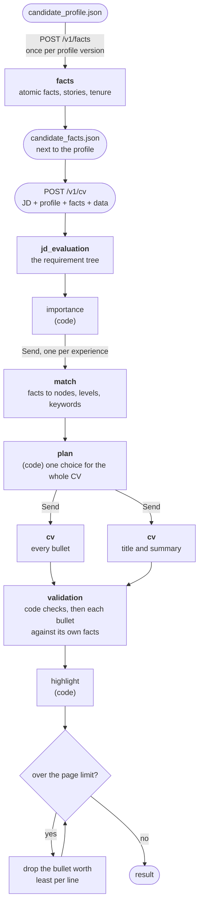

# CV pipeline v2: design

Status: draft, 2026-11-10. Nothing here is built yet. This is the design for
the v2 branch; when v2 ships, it replaces [doc/cv-pipeline.md](doc/cv-pipeline.md),
which describes v1.

## Summary

v1 builds the CV out of the profile's duties exactly as they are written, and
decides what to show in prose, across several model calls that each see only
part of the CV. That causes four problems: the JD's requirement tree is
flattened, the CV mirrors the profile's wording, each experience is tailored
on its own, and the coverage score rewards repetition.

v2 compiles the CV the way a compiler builds a program. The profile is
compiled once into atomic facts. The JD becomes a requirement tree, with
importance computed in code. A model matches the facts to the tree. A
pure-Python planner then chooses the whole CV at once against one objective:
cover the JD before repeating it, in the JD's own proportions. A writer turns
the plan into text. Models understand and write; code does the arithmetic.

It deletes `format_selection` and the formats, the `|3-80,7-40` score
suffixes, the highlight call and `capped_coverage`.

## 1. Why: four problems in v1

Measured on 46 CV runs of real applications (kept in the private data folder,
not in this repository) and on the test set's quick evaluation of 2026-11-10.
[Appendix A](#appendix-a-how-the-v1-numbers-were-measured) says how each number
was counted.

### 1.1 The requirement tree is flattened

`jd_evaluation` builds a tree in its reasoning: leaves, grouped into skills,
grouped into disciplines. But it outputs only a flat list of items, each with
its own importance. The parent–child link is lost, and the prompt makes up for
it with arithmetic: a discipline next to its own skills gets "about 50, never
below 45, never above its best skill".

`profile_scoring` then folds three different relations into one 0–100 score:

| Relation | Example | What it proves | Hits an ATS keyword search |
|---|---|---|---|
| literal | the CV says "Terraform"; the JD asks for Terraform | the leaf | yes |
| more specific | Terraform, against "Infrastructure as Code" | part of the node | only if the node lists the term |
| more general | "Cloud Ops", against Terraform | no leaf; it claims the area | no |

The prompt's anchors ("100: the item is the skill, or fully implies it; 50: a
large part of a more generic skill") cover the first two relations. The third
has no anchor at all. And nothing in the pipeline ever computes a literal
match; only the evaluation does.

The skills section shows the cost. The body writer copies "the items scored
higher", with no idea of overlap: two skills under one node are both taken,
and a skill whose name is itself a key point scores 100 whatever else already
covers it. On 2026-11-08, 7 of 8 CVs listed both "Stakeholder Management" and
"Solution Architecture". On the test set, the keyword half of `appeal` is the
weak half: 48.5, against 73.8 for the experience half.

### 1.2 The CV mirrors the profile's wording

951 of 972 CV duties (98%) are a single profile duty, rewritten. In 46 runs
there were 13 merges and 4 splits, even though the duties prompt allows both.
Two causes:

- **The duty as written is the only unit.** Everything is scored, selected and
  trimmed on it. A long duty that tells three things gets up to 4 matches (a
  third of all scored duties hit that cap) and is kept or dropped whole. A short
  duty that tells one thing competes with it on unequal terms.
- **The score suffix travels through the writer.** The writer must keep the
  suffix on each duty, so any merge or split means recomputing it by hand.

So the profile's cut decides the CV. The system can only show what the profile
happened to put in one sentence.

### 1.3 Each experience is tailored on its own

`format_selection` sees every experience, but it only chooses which ones are
shown and how many duties each gets. Each experience is then written in its own
call, told to show "the important sides of the job, not only one" and to apply
the coverage rule to its own duties. So every experience chases the JD's top
key points, whatever the others already show.

In one Technical Lead posting, the leadership requirement was matched in all
three experiences shown (strongly in two of them), while the Java requirement,
weighted 95, was matched strongly by a single bullet.

The rewriting tilts the same way. The writer sees the JD's ranked key points
and steers each duty toward the top ones. About 1 in 8 rewritten duties (116 of
951; an upper bound, since the count includes word-form changes) gain
leadership words their source lacks. In one case, a duty where the candidate
supported a team that managed a vendor came out as the candidate managing the
vendor, and validation let it through.

### 1.4 The coverage score rewards repetition

`capped_coverage`, and the same rule written out in the duties prompt, scores a
set of duties as the sum, over the key points, of min(the 2 best duty scores
added up, 2 × importance). Two properties follow:

- **Importance is a cap, not a weight.** A first match scored 80 is worth 80
  points whether the key point's importance is 40 or 100.
- **Past the cap or the second match, a duty is worth 0.** The remaining places
  are filled "with the best of the others", by raw score, and broad key points
  that many duties touch win them. 26% of key points are shown by 3 or more
  strong duties; in one posting, a single requirement was shown by 10.

The result: a third proof of the job's core requirement is worth exactly as
much as a tenth proof of a minor one, which is nothing.

The scores are also coarser than they look. 99.9% of them are multiples of 5,
and the most common value, 30, sits just above the cutoff of 25: the 0–100
scale is used as about 15 levels. LLM raters are known to be inconsistent on
fine numeric scales, with skewed score distributions [3].

### 1.5 What the evidence says about the order of the work

This simulation reruns the same runs with the same duties, scores and number of
duties. Only the selection rule changes, to one global greedy pass over the
objective of [section 5](#5-the-objective):

| Units | Important key points covered | Strong proofs past the 2nd | Distance from the JD's proportions |
|---|---|---|---|
| duties as they are | 6.80 → 6.87 | 7.9 → 8.5 | 0.263 → 0.246 |
| each duty cut to its best match (a stand-in for atomic facts) | 5.61 → 5.89 | 4.09 → 3.54 | 0.297 → 0.243 |

On today's duties, a global optimizer barely helps: +3.4%, even measured by
v1's own `capped_coverage`. A duty picked for one new match drags its other
three matches along. On narrow units, the optimizer starts to work. (Compare
within a row: the second row counts fewer matches.)

**So the units come first.** A global planner over crammed duties isn't worth
building.

## 2. Goals and non-goals

Goals:

1. **A real tree.** The JD's requirements are kept as a tree. Literal keyword
   coverage and proven-capability coverage are scored separately, and a general
   or a specific skill counts for what it adds.
2. **Independent of the profile's wording.** The CV no longer depends on how
   the profile cuts its duties; the system can split, merge and reorder them.
3. **One global selection.** An experience is shown for what it adds to the
   whole CV, not to itself.
4. **One objective.** The same objective plans, trims and reports. It
   approximates the JD's proportions and favours coverage over repetition.
5. **Fewer moving parts.**

Non-goals:

- The LaTeX template and render, the letter, JD detection and analysis, the
  sessions and the event stream stay as they are. The result `document` keeps
  its shape: bullets land in each experience's `duties`.
- No style rule changes. The writing prompts' sections on tone, agency, sentence
  variety and AI clichés carry over word for word. No rules on metric density,
  bullet formulas or action verbs are added.
- No embeddings and no external skills taxonomy. The tree is built from the
  JD's own words, because those are what an ATS searches for.
- Nothing personal is cached on the server.

## 3. The design at a glance



| Step | Runs on | Input → output | Replaces |
|---|---|---|---|
| facts | a model, once per profile version | the profile → atomic facts per experience, grouped in stories, plus one tenure fact per experience | (new) |
| jd_evaluation | a model, 1 call | the JD → nodes with parents and keywords; leaves labelled with section, position and qualifier | the flat key points |
| importance | code, pure | the labelled leaves → a weight per node | the arithmetic in the JD prompt |
| match | a model, 1 call per experience + 1 for the profile's lists | facts × tree → each fact's nodes (at most 2), levels 1–3 and the JD keywords it supports; literal hits found in code | profile_scoring |
| plan | code, pure | all of the above → which facts, in which bullets, in which experiences; the list items; each bullet's angle and keywords | format_selection, FORMATS, the selection rules of the duties prompt |
| cv | a model: 1 call for all the bullets, 1 for title and summary | the plan → text | the body call and one call per experience |
| validation | code, then a model per experience | the text and its facts → replacements | validation, with a narrower input |
| highlight | code, pure | the text and the plan → `**bold**` and `*italics*` | the highlight call |
| fit | code | the render → drop the bullet worth least per line until it fits | the capped_coverage trim |

The model roles become `facts`, `jd_evaluation`, `match`, `cv` and `validation`;
`profile_scoring`, `format_selection` and `highlight` go away. v2 also makes fewer
calls per CV: no format selection, no highlight call, 2 writer calls instead of
1 + one per experience, and 6 match calls instead of 9 scoring calls (for the
example candidate).

Terms used below:

- **fact:** one atomic statement from the profile.
- **story:** the facts that tell one event together.
- **node:** one requirement of the JD in the tree; a v1 key point.
- **leaf:** one fragment of the JD's text, attached to a node.
- **weight:** a node's importance, from 0 to 100.
- **contribution:** how much a fact proves a node, from 0 to 1.
- **angle:** what a bullet is in the CV to prove.
- **licensed keyword:** a JD keyword that a bullet's facts honestly support.

## 4. The steps

### 4.1 Facts

The profile is compiled into facts, one call per experience, fanned out with
LangGraph `Send`. Facts don't depend on the JD, so this runs once per profile
version, not once per CV: `POST /v1/facts` takes the profile and returns the
fact base. The client stores it as `candidate_facts.json` next to the profile,
together with the profile's SHA-256, and compiles again whenever the hash
changes. The profile stays the source of truth and keeps its format: to fix a
fact, you fix the profile.

A fact, from the fictional candidate in `examples/candidate`:

```json
{
  "id": "e1.f4",
  "experience": 1,
  "story": "e1.s2",
  "part": "action",
  "text": "I placed an SLB in front of the MSSQL database to point to the master instance.",
  "source": ["I placed an SLB in front of it to point to the master instance"],
  "agency": "did",
  "scope": "",
  "tech": ["SLB", "MSSQL", "Alibaba Cloud"],
  "metrics": [],
  "outcome": ""
}
```

- **`text`:** one statement, in the profile's own words, first person, past
  tense, with nothing added.
- **`source`:** the span or spans of the profile the fact comes from, copied
  verbatim. Code checks that each span is a substring of the experience
  (whitespace normalized) and drops a fact that fails, with a log line. This
  check is what makes the fact base safe to compose from.
- **`story` and `part`:** facts that tell one story share a story id, and each
  is a `context`, an `action` or a `result`. A result enters the CV only with its
  action, and a context only with what it explains. "Placed an SLB in front of
  the master instance" means nothing without "the MSSQL high-availability design
  did not fit Alibaba Cloud".
- **`agency` and `scope`:** `agency` is `led`, `did` or `supported`. Together
  with `scope`, it carries what the profile states in its notes: "I guided my
  team, NOT the rehearsals" becomes the scope of the rehearsal fact, never a fact
  of its own.
- **`tech`, `metrics` and `outcome`:** named the way the profile names them. They
  feed the highlight (`tech`) and the two meta nodes (`outcome`, `metrics`).

Each experience also gets one **tenure fact**: title, company, dates, the
duration in years and the main technologies. It stands for the years a
recruiter counts, and it is shown in the experience's header, not as a bullet.

Facts are personal data. The server never stores them: they arrive with every
CV request as the `candidate_facts` part, just like the profile
(`CandidateInputs` gains a `facts` field).

### 4.2 Requirement tree and importance

The JD prompt keeps everything it does today: leaves, qualifiers, grouping,
English-only keywords, no degrees, no years. What changes is that it outputs
the tree instead of flattening it, and it stops computing importance. It
labels each leaf, and code turns the labels into weights. This is the "Stage
2" that the 2026-11 `jd_evaluation` rework left open.

```json
{
  "nodes": [
    {"id": 1, "parent": null, "kind": "title", "name": "Platform engineer", "keywords": ["Platform Engineer"]},
    {"id": 2, "parent": null, "kind": "discipline", "name": "DevOps engineering", "keywords": ["DevOps"], "named": false},
    {"id": 3, "parent": 2, "kind": "skill", "name": "Infrastructure automation",
     "keywords": ["Terraform", "Ansible", "GitLab CI", "Infrastructure as Code"]}
  ],
  "leaves": [
    {"node": 3, "section": "requirements", "position": 1, "qualifier": "strong", "hedged": false,
     "text": "solid Terraform experience"}
  ]
}
```

The node kinds are `title`, `responsibility`, `skill`, `discipline` and
`language`. Importance is computed by a pure function whose constants start as
the v1 prompt's numbers:

| Rule | The v1 prompt's numbers, now constants |
|---|---|
| requirement qualifier | strong 75–90, good 60–75, plain or none 40–60, weak or hedged 10–30 |
| responsibility verb | owns the result 70–85, does the work 55–70, helps 40–55; when most responsibilities "own", spread them over 55–85 |
| position | within its range, linear from the first leaf of its section (top) to the last (bottom) |
| node | its strongest leaf, plus a bonus for each extra leaf from another bullet or section |
| discipline | inferred, with all its leaves in its skills: 50. Inferred, with leaves of its own: 55–70. Named by the JD: the naming leaf − 10 when 2 or more of its skills are nodes. Never below 45; an inferred discipline never above its best skill |
| qualifier order | among requirements, a node never weighs less than a node with a weaker qualifier; disciplines are exempt |
| title | 100 |
| English | 10–30, more when the JD stresses it |
| meta nodes | "success stories" 40 and "concrete examples" 35, added by code |

Tuning importance becomes editing a table that has unit tests. Today it means
rewording a prompt and measuring the effect again; much of the 2026-11 rework
went into exactly that (compression at 80 and above, relative verb levels, the
discipline floor).

### 4.3 Match

One call per experience (`Send`), plus one call for the profile's lists
(skills, certifications, job titles). The model is shown the tree without
weights, plus the experience's header and its facts. For each fact it returns:

```json
{"fact": "e1.f4", "matches": [{"node": 7, "level": 3, "keywords": ["High Availability"]}]}
```

- **At most 2 matches per fact,** each at the most specific node the fact
  proves. A fact never matches a node more specific than itself: "Cloud Ops"
  matches DevOps engineering, not Terraform.
- **Three levels instead of 0–100.** 3: the fact is the node's work, done. 2: a
  substantial part of it. 1: it touches it.
- **`keywords`:** the node's keywords that this fact honestly supports, copied
  from the node. This is the licence the writer will use.
- **Literal hits come from code.** A node keyword found in the fact's text or
  `tech` is supported by definition.

A match contributes `c = level / 3` to its node, and half of that for each
level up to its ancestors. Nothing flows down: a general fact or skill covers
its own node and never that node's children.

### 4.4 Plan

`plan(tree, weights, facts, matches, budget) → Plan` is a pure function. It
chooses the whole CV at once by maximizing the objective of
[section 5](#5-the-objective).

- **Candidates.** Each fact that can stand alone (an action, or a fact outside
  any story) is one candidate bullet. Each story is also offered as bundles:
  context + action, action + result, or all three. A bundle is one bullet when
  its estimated length fits, otherwise two consecutive bullets, as v1's "STAR
  story over two duties" did.
- **Costs.** A bullet costs its estimated lines. Showing an experience costs its
  header (title, company, dates, role summary), once. Both constants are
  calibrated on v1's renders.
- **No formats.** An experience is shown when its facts, its tenure fact
  included, add more than its header costs. The most recent and the longest
  experiences are always shown, as in today's `format_selection` rule.
- **Greedy.** Start with the headers of the mandatory experiences. Repeatedly
  add the candidate with the best gain per line, counting the header if its
  experience isn't shown yet, for as long as it fits the budget. Then make sure
  each shown experience has at least 2 bullets: add its best remaining one, or
  drop the experience if that loses less. With 40–80 candidates and about 20
  bullets, this takes milliseconds.

```python
def plan(candidates, budget, mandatory):
    shown, chosen = set(mandatory), []
    used = sum(header_lines(e) for e in mandatory)
    while True:
        open_ = [c for c in candidates if not overlaps(c, chosen)]
        cost = {c: c.lines + (0 if c.experience in shown else header_lines(c.experience)) for c in open_}
        fits = [c for c in open_ if used + cost[c] <= budget]
        if not fits:
            break
        best = max(fits, key=lambda c: (F(chosen + [c]) - F(chosen)) / cost[c])
        if F(chosen + [best]) <= F(chosen):
            break
        chosen.append(best)
        used += cost[best]
        shown.add(best.experience)
    return at_least_two_bullets(chosen, shown)
```

The same objective then decides the rest:

- **Angles.** Each bullet is tagged with the node or nodes it added the most to
  when it was picked: what it is in the CV to prove.
- **Keywords.** Each bullet gets at most 2 of its facts' licensed keywords: those
  that add the most to the literal term, with keywords not yet in the CV first.
- **List items.** Each array field of the body schema that has the same name as
  a profile list (`skills` and `certifications` in the shipped schema) is filled
  from the plan, up to the schema's `maxItems`, copied verbatim:
  - **Literal first.** An item that contains a JD keyword goes in first, ranked
    by its node's weight.
  - **Then new coverage.** After that, items go in when they cover a node that
    nothing selected covers yet.
  - **No doubles.** Two items under one node are both taken only if both are
    literal hits.
  - **Ties.** A tie between certifications goes to the most recent.
- **Summary targets.** These are the heaviest nodes the selection backs, plus
  the important nodes covered only by list items or tenure: the summary is where
  those get a sentence.

The plan goes to the client as an artifact, together with a report: F, each
node's coverage, the CV's share of each node against the JD's share, and the
literal hits.

### 4.5 Compose

**Bullets** are written in one call covering every experience. The writer is
shown the writing style, the experience schema and, for each experience, its
profile fields and its planned bullets. Each planned bullet comes with:

- its facts (text, agency, scope, tech, metrics, outcome);
- its angle, as node names;
- its licensed keywords.

The writer is not shown scores, weights or the JD's ranked list, so it has
nothing to steer the wording toward except each bullet's own angle.

The writer then:

- **Writes the bullets** in plan order, and may reorder them within an
  experience for the story's sake.
- **Writes the role summaries.**
- **Copies the header fields** as the schema asks, exactly as v1's duties prompt
  does. The code still assumes nothing about the experience fields beyond `id`
  and `duties`.

Seeing the whole CV in one call, the writer can vary openers and verbs across
experiences; v1's "no two duties start with the same word" holds only within one
experience.

What happens to the sections of `sys_prompt_cv_duties.txt`:

- **Carried over word for word:** tone, agency, sentence variety (shapes a–l)
  and AI clichés.
- **Removed:** the paragraphs on selection, merging or splitting, and scores.

**Title and summary** come from one call that runs beside the bullets. It writes
the job title from the profile's titles (a title that contains a JD title
keyword is preferred) and the summary, from the summary targets and their facts.
The body schema's list fields are filled by code from the plan
([section 4.4](#44-plan)), so no model copies skills or certifications.

**Length limits** follow the house rule: the prompt states the soft limit (200
characters per bullet), while the schema and the validation hold a hard limit
50 characters wider. The planner budgets with the soft limit.

### 4.6 Verify

Code checks come first:

- **Keywords:** each bullet contains its licensed keywords (whole word).
- **Format:** each bullet is within the hard limit, ASCII only, and has no
  leftover markers.
- **Agency:** a bullet that says led, managed, owned, directed or headed while
  none of its facts has `agency: led` is flagged.

Then the v1 review loop runs (`cv_review`, the `replace_in_*` tools, up to 5
rounds), once per experience with `Send`, on a narrower input: each bullet with
its own facts, their source spans, and the flags. It checks claim by claim that
every statement in a bullet is backed by that bullet's facts, the decomposition
FActScore uses to check long text [4]. A missing keyword is fixed there, with a
minimal replacement, when the facts support it. The body is checked against the
facts of its summary targets and against the profile's summaries.

### 4.7 Highlight

Highlighting is done in code, from the plan. v1's rules become exact:

- **Bold in skills:** the 2 literal skills with the heaviest nodes.
- **Bold in bullets:** up to 5 licensed keywords found in the text, heaviest
  node first, at most 1 per bullet. Never the same term twice in the CV, nor a
  variant of it (one term containing the other, ignoring case). Never in the
  summary or a role summary.
- **Italics:** up to 10 technologies from the facts' `tech` that appear in the
  bullets and are not already bold.

With no model call, the "kept the original" fallback is gone too.

### 4.8 Fit

The v1 loop stays: render, count the pages, and while the CV is over the limit,
drop the bullet whose removal loses the least F per line, among experiences that
have more than 2 bullets. When no bullet can go, keep the longer CV. The
planner's length estimate should make this rare.

## 5. The objective

Each node n has a weight wₙ from 0 to 100. Each selected bullet b gives each
node a contribution c(b, n) between 0 and 1: the highest contribution of the
bullet's facts to that node (level / 3 at the matched node, halved for each
level up to an ancestor). Sort the contributions to n from largest:
c₁ ≥ c₂ ≥ … Let hₙ be the number of distinct licensed keywords of n that appear
in the CV.

```text
F(S) = Σₙ wₙ · Σⱼ cⱼ / dⱼ   +   λ · Σₙ wₙ · Σ_{j ≤ hₙ} 1 / dⱼ        dⱼ = 2j − 1  (1, 3, 5, …)

subject to:  lines of the chosen bullets + headers of the shown experiences ≤ page budget
```

What this does:

- **First proofs count most.** The first proof of a node counts in full, the
  second a third, the third a fifth. Covering a new requirement beats repeating
  one. Once everything the profile can prove is covered, leftover space goes to
  the important requirements, not to a tenth proof of a minor one.
- **It approximates the JD.** If each fact proved one node in full and every
  bullet cost the same, the greedy pass would be exactly Sainte-Laguë
  apportionment. Bullets are the seats, nodes are the parties, the JD's weights
  are the votes, and each node's share of the CV tends to its share of the JD.
  Divisors 1, 2, 3 would give D'Hondt instead, with more depth on the heaviest
  nodes; that is the method proportional approval voting induces [2]. The divisor
  sequence is the one knob. The goal is coverage over repetition, so v2 starts
  with Sainte-Laguë.
- **Literal and proven coverage are separate.** The first term counts what is
  proven. The literal term counts the JD's own words in the CV, which is what a
  keyword search hits, with the same divisors over each node's distinct
  keywords. λ trades the two; it starts at 0.5.
- **It is easy to optimize.** Each node's first term is a non-negative sum of
  top-k sums, and the literal term is a concave function of a coverage count.
  So F is monotone submodular. Greedy selection is the standard method for this
  class, with constant-factor guarantees under a budget; Lin & Bilmes use it to
  build summaries [1]. The header costs bend the textbook guarantee, which does
  not matter with 40–80 candidates.
- **The meta nodes stop flooding.** In v1, "concrete examples" was shown by up
  to 10 strong duties in a single CV. Under F, a fifth proof of that weight-35
  node is worth 35 / 9 ≈ 4.

A worked example, with made-up weights. Team leadership (90) already has one
full proof. The next candidates, each a full proof (score 100 in v1, level 3 in
v2):

| Candidate | v1 capped_coverage gain | F gain (Sainte-Laguë) |
|---|---|---|
| 1st proof of Agile (65) | 100 | 65 |
| 1st proof of SQL (40) | 80 | 40 |
| 2nd proof of Team leadership (90) | 80 | 30 |
| 3rd proof of Team leadership | 0 | 18 |
| 2nd proof of SQL | 0 | 13 |

v1 ties a second leadership proof with a first SQL proof, and it can't tell a
third leadership proof from a second SQL proof, because both are worth 0. That
is where raw score takes over. F puts all five candidates in order.

## 6. What changes on the wire

v2 is 2.0.0: the CV request changes incompatibly.

| | v1 | v2 |
|---|---|---|
| new endpoint | (none) | `POST /v1/facts`: `candidate_profile` in, the fact base out, in the usual envelope; optional `sys_prompt_facts` and `facts_extra_body` |
| `POST /v1/cv`: new parts | | `candidate_facts` (required); `sys_prompt_match`, `sys_prompt_cv_bullets`, `cv_bullets_schema`, `sys_prompt_validation_bullets`; `match_extra_body` |
| `POST /v1/cv`: removed parts | | `sys_prompt_profile_scoring`, `sys_prompt_format_selection`, `sys_prompt_cv_duties`, `cv_duties_schema`, `sys_prompt_validation_duties`, `sys_prompt_highlight`; the extra bodies of `profile_scoring`, `format_selection` and `highlight` |
| `POST /v1/cv`: kept parts | | `sys_prompt_jd_evaluation`, `sys_prompt_cv_body`, `cv_body_schema` (unchanged; code fills its list fields from the plan), `sys_prompt_validation_body`, `template`, `images`, `pages` |
| roles in `models.toml` | jd_evaluation, profile_scoring, format_selection, cv, validation, highlight | facts, jd_evaluation, match, cv, validation |
| artifacts (`steps/`) | key_points, scored_profile, score_reasons, format_selection, cv_body, cv_experiences, checked_body, checked_experiences, highlighted_resume | requirement_tree, matches, plan (with its report), cv_body, cv_bullets, checked_body, checked_bullets, highlighted |
| `CandidateInputs` | profile, preferences, data | + facts |

The duties and scoring prompts get new names because their input changes: a v1
override sent under the old name must not be read as a v2 prompt.

The client:

- **Facts before each CV.** Before a CV request, it compiles the facts if
  `candidate_facts.json` is missing or its `profile_sha256` differs from the
  profile's. Then it sends them as `candidate_facts`.
- **`cv.toml`.** `[files]` gains `prompt_facts`, `prompt_match`,
  `prompt_cv_bullets`, `schema_cv_bullets` and `prompt_validation_bullets`. It
  loses `prompt_profile_scoring`, `prompt_format_selection`, `prompt_cv_duties`,
  `schema_cv_duties`, `prompt_validation_duties` and `prompt_highlight`.
  `[extra_body.<role>]` follows the new roles.
- **Override files must be ported by hand.** The `sys_prompt_*.txt` files in the
  candidate folders don't carry over: a file under a removed name is simply not
  sent anymore.

## 7. What gets deleted

- **`format_selection`:** its prompt, its role, `FORMATS` and the step.
- **The `|3-80,7-40` protocol:** `SCORES`, `suffix()`, `scores_of()`,
  `without_scores()`, the suffix half of `keep_words()`, and every prompt line
  about scores.
- **The highlight call and `keep_words()`.**
- **`capped_coverage`, `COVERAGE_CAP` and `COVERAGE_BEST`:** F replaces them.
- **The `profile_scoring` prompt:** replaced by `match`.
- **The importance arithmetic in the JD prompt:** replaced by code.
- **Parts of the duties prompt:** the paragraphs on selection, merging or
  splitting, and scores.

## 8. How v2 keeps the house rules

- **One job per class.** A fact compiler, the tree step, a matcher, a planner, a
  composer, the reviewer (`cv_review`, reused), a highlighter, and `CVRenderer`
  unchanged. `CVGenerator` only wires the graph.
- **The pipeline is a library.** Importance, the plan, F, the highlight and the
  trim are pure functions of values. Nothing reads configuration.
- **No hidden global state.** The page constants and the constants of importance
  and F are immutable module constants, the same for every request, or they are
  arguments.
- **Fan-out through LangGraph `Send`:** facts per experience, match per
  experience, bullets beside the body, validation per experience. A code node
  puts the answers back in order, as in v1.
- **Contracts.** The fact base gets a pydantic model in `cv_contracts`, which
  still depends on pydantic only.
- **Failures carry a stage:** `facts`, `cv.jd_evaluation`, `cv.match`,
  `cv.plan`, `cv.cv`, `cv.validation`, `render`.
- **Tests.**
  - **Pure functions:** importance, the plan, F, the highlight and the trim get
    unit tests on hand-made values. One test checks that with one node per fact,
    the plan's allocation equals Sainte-Laguë's.
  - **The graph:** its test keeps the fake HTTP client inside a real
    `ModelSelector`.
  - **The render:** the golden render stays.
  - **No outside dependencies:** no test needs a key, a network or a terminal.

## 9. Evaluation

- **Thorough runs decide.** Run cv-eval thorough (50 CVs) on v1 and on v2, on
  the same day with the same judge. Quick runs are noise: re-judging the same CV
  moves appeal by up to 3 points. Compare appeal and both its halves, ai,
  readability and cosine.
- **The plan report is a diagnostic.** Per CV: important nodes covered, proofs
  past the 2nd, distance from the JD's proportions, and literal hits. It is
  measured on the pipeline's own tree, so it is not a quality score.
- **Tune on the dev runs.** Trying ideas and tuning happen on the private
  data-folder runs; the test set is only for scoring.
- **Expect modest appeal gains.** On the quick set, only 11 of 97 keyword misses
  (weight 22 of 180) are terms the example profile contains verbatim; the rest
  are gaps of the fictional candidate. So literal-first alone is worth about +3
  appeal. The larger expected effects (less repetition, experiences that keep
  their own focus, proportional emphasis) are only partly visible to the judge.

## 10. Risks

| Risk | Mitigation |
|---|---|
| Facts lose meaning when split | stories and bundles from day one; the probe reads every story |
| The compile invents or drifts | verbatim source spans checked in code; a strong model; one compile per profile, so it can be read |
| Licensed keywords turn into stuffing, against `ai_tells.md` | at most 2 per bullet; the verifier strikes unsupported ones |
| Length is estimated before the writing | the planner budgets with the soft limit; the trim stays |
| Every prompt's input changes, so tuned behaviour is reset | style sections carried word for word; expect a tuning round |
| One writer call for all bullets is a single point of failure | the selector's 3 attempts; a failed call fails the job with its stage, as today |
| The gain is too small to measure | the probe's go/no-go before any code; thorough runs after |

## 11. Plan of work

**Phase 0: the probe, with no repository change.** Scratch scripts only.

1. **Pick the runs.** About 10 runs from the private data folder, across role
   families (management, architecture, lead, technical). Leave out any whose JD
   overlaps a test JD, comparing the text.
2. **Compile the facts.** Run the compile once on the candidate with a strong
   model, then read the result: every source span verbatim, every story whole,
   the notes kept as scope.
3. **Match.** Match the facts against each run's existing `key_points.json`,
   treated as flat nodes, with a draft match prompt.
4. **Plan.** Run the planner and compare each plan with the run's CV on the four
   numbers of the plan report.
5. **Read two plans closely.** The Technical Lead posting where Java (weight 95)
   was matched strongly by one bullet; and a development role, to check that its
   bullets stay development.
6. **Compose.** Write 3–4 CVs from plans and read them next to v1's.

Decide these criteria before running. Go if:

- the plans have fewer proofs past the 2nd in at least 7 of 10 runs;
- the average distance from the JD's proportions is lower;
- no important key point that v1 covered is lost;
- the composed CVs read at least as well as v1's.

**Phase 1: the core, on flat key points.** Build facts (endpoint and client
compile), match, plan, cv, validation, and highlight in code. Each v1 key point
is a node with no parent, and the JD prompt is unchanged. This deletes
`format_selection`, `FORMATS`, the suffix protocol, the highlight call and
`capped_coverage`. It fixes problems 2, 3 and 4, and the literal term and the
list rule already address part of 1. Run a thorough evaluation against v1.

**Phase 2: the tree.** `jd_evaluation` outputs the tree and the labels,
importance moves to code, match attaches each fact at the most specific node,
and contributions flow to ancestors. This fixes problem 1. Run a thorough
evaluation against Phase 1.

## 12. Alternatives considered

- **A global optimizer over v1's duties.** +3.4% in simulation; the units are
  the problem.
- **One model call choosing the whole CV.** That is still optimization in prose.
  `format_selection` chose format A in about 96% of its decisions until its
  prompt was rebalanced.
- **Embedding similarity to match facts.** Similarity isn't proof, and the cosine
  is already scored separately.
- **An external skills taxonomy.** An ATS searches for the JD's words, so the
  tree is built from them.
- **Decomposing facts on every CV request.** That adds variance and cost to every
  CV. It is how the probe runs, not the product.
- **A writer per experience.** It parallelizes better but cannot vary the CV as
  a whole.
- **A smooth saturating objective (1 − e^(−x)).** One more parameter, and no
  reading as apportionment.

## 13. Open questions

1. **Divisors.** Start with Sainte-Laguë (1, 3, 5), or with D'Hondt?
2. **λ, the weight of the literal term.** Start at 0.5?
3. **Meta nodes.** Keep the two meta nodes, with fixed weights of 40 and 35?
4. **A coverage check on the compile.** Should it also check that every profile
   duty yields at least one fact? Not designed in, to keep it simple.
5. **Missing keywords.** Should a missing licensed keyword be fixed by the
   verifier (as designed), or only reported?
6. **Recency.** None, as in today's `format_selection`, whose "newer experiences
   get more duties" rule was removed. Confirm.
7. **Hand edits to facts.** Facts are regenerated from the profile and never
   edited by hand. Confirm.

## Appendix A: how the v1 numbers were measured

All the numbers come from the artifacts each run stores under `steps/`: 46 runs
in the private data folder, from October 2026 to 2026-11-08, each with the v1
prompts of its day. The rest come from the test set's quick run of 2026-11-10.
The scripts were throwaway; these are the counting rules:

- **One-to-one, merge, split.** A CV duty (`cv_experiences.json`) maps to the
  profile duty of the same experience with the same score suffix, since the
  writers copy it: that is one-to-one. A suffix equal to the union of two source
  suffixes (the higher score per key point) is a merge. A source duty used twice
  is a split.
- **Matches and scores.** Every match in `score_reasons.json` (5,897), and the
  matches per profile duty (1,472 duties).
- **Repetition.** In `highlighted_resume.json`, for each key point except the
  title and the two meta items, the duties scoring 60 or more on it (548 key
  points in all).
- **Tilt.** For each one-to-one duty after validation
  (`checked_experiences.json`): leadership words present in the CV duty but not
  in its source. The words are led, lead, managed, mentor…, coordinat…, my team,
  team leader, drove, supervis…, direction, ownership and owned.
- **Simulation.**
  - **The pool:** every profile duty of every experience, with its scores.
  - **The greedy:** it picks as many duties as the v1 CV has, at most 9 per
    experience, by gain in F (Sainte-Laguë, meta items excluded), with no page
    model.
  - **"Important key points covered":** importance 50 or more, the profile has a
    duty scoring 40 or more on it, and the CV one scoring 60 or more.
  - **"Distance from the JD's proportions":** the total variation between the
    CV's share of score per key point and the JD's share of importance, over the
    key points the profile can prove.
  - **The second row:** keeps only each duty's best match, in both the v1
    selection and the greedy.
- **Evaluation breakdown.** appeal = 50 × (keyword hits / total + experience
  shown / (2 × total)), with weights must 2 and nice 1 (`cv_eval.py`). A keyword
  miss counts as "in the profile" when one of its keywords appears, as a whole
  word, in `examples/candidate/candidate_profile.json`.

## References

1. H. Lin, J. Bilmes. [A Class of Submodular Functions for Document Summarization](https://preview.aclanthology.org/fix_video/P11-1052.pdf). ACL 2011.
2. M. Brill, J.-F. Laslier, P. Skowron. [Multiwinner Approval Rules as Apportionment Methods](https://arxiv.org/abs/1611.08691v2). AAAI 2017; Journal of Theoretical Politics 30(3), 2018.
3. R. Stureborg, D. Alikaniotis, Y. Suhara. [Large Language Models are Inconsistent and Biased Evaluators](https://arxiv.org/abs/2405.01724v1). 2024.
4. S. Min et al. [FActScore: Fine-grained Atomic Evaluation of Factual Precision in Long Form Text Generation](https://arxiv.org/abs/2305.14251). EMNLP 2023.
