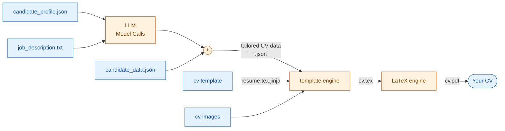

# Resumix

[](https://github.com/gcontini/resumix/actions/workflows/ci.yml)
[](https://app.codacy.com/gh/gcontini/resumix/dashboard?utm_source=gh&utm_medium=referral&utm_content=&utm_campaign=Badge_grade)
[](LICENSE)

Turn a job description and your work experiences into a tailored, two-page TeX CV and a cover letter, using any OpenAI-compatible model.

Produces an honest CV that you can actually defend in a job interview. Though you can change the cv layout, the focus is on the CV content optimization for ATS.

<div align="center">
  <a href="examples/sample_cv.pdf">
    
  </a>
</div>

Features:
- **Analyses** the Job Description you select against your profile — match score, salary, skills, gaps (optional).
- **Writes** an honest CV tailored to the posting, reviewed against your profile for
  invented claims, condensed until it fits two pages, with matching keywords
  highlighted.
- **Renders** real LaTeX to a PDF, and optionally a cover letter.
- It can watch your **clipboard** or a **folder** for  multiple generation, or run **once** on a single file.

You need to provide:
- A list of your work experiences, skills, the more you put the better the CV will be (as long as you can defend it in an interview). You don't have to worry about writing them in a perfect style: `resumix` will fix it for you.
- Some customization data for the cv (your phone, linkedin...)
   - a signature scan - looks good on your cv. 
- The job description
- You api key and model configurations 

## Will it work for me?

It started as my own personal lab to learn AI assisted coding and to pass the ATS with flying colors. It's not tested across different cv formats and sizes. It's sized for a well established professional with >10 
years of experience and 3-8 working experiences. 

It is focused on getting the content of the CV "right" instead of customization of presentations. It will give you full control on every aspect of the CV, but you must be prepared to invest some time in it before you can get it to work well. It will be always less than if you implement it from scratch (I hope). Ask on the [forum](https://github.com/gcontini/resumix/discussions) for help or open an issue. I will be happy to help.

It took me a couple of weeks to get it to this point. If you start from scratch the points you're going to spend time on are:

* prepare the templates for your cv
* the models will continue exaggerate your experiences and to pass the lenght limits until you put in place a review step.
* the whole review process has to be tuned (temperature=0, retries...) or it will not converge nor find errors.
* the models thinking budgets need to be tuned or they will consume all your token plan with no added benefit.
....

## Download and run

resumix is two pieces: a server that holds the model keys and the LaTeX
toolchain, and a client executable you run on your machine. Neither needs the
other installed locally — the client talks to the server over HTTP.

**1. Run the server** — a container image, published on Docker Hub:

```bash
docker run -d -p 8080:8080 \
  -e MODEL_API_KEY=... \
  lmstch/resumix:latest
```

Any OpenAI-compatible provider works — see
[`server/README.md`](server/README.md) for the other providers and the full
environment table. `curl localhost:8080/healthz` should report `pdflatex: true`.

**2. Get the client** — it is released from main, and the same client talks
to this 0.5 server and to a 1.x one, side by side: give this server a folder
of its own next to the others. Its
[`client/README.md`](https://github.com/gcontini/ats-strike/blob/main/client/README.md)
covers the modes, the configuration and the output layout.

## Architecture

Below how the data you provide is merged to create the final CV:



You can download `"tailored CV data.json"` and `cv.tex` toghether with the final pdf, in case you want to modify something manually and resubmit them for rendering via the client.

Package boundaries, what crosses the wire, and the async job model are in
[doc/architecture.md](doc/architecture.md).

## Development

```bash
uv sync
uv run pytest                   # all three suites; no API key, no network
uv run ats-strike               # the server, from source
uv run --group docs mkdocs serve  # the documentation site, on :8000
```

## License

MIT — see [LICENSE](LICENSE).
