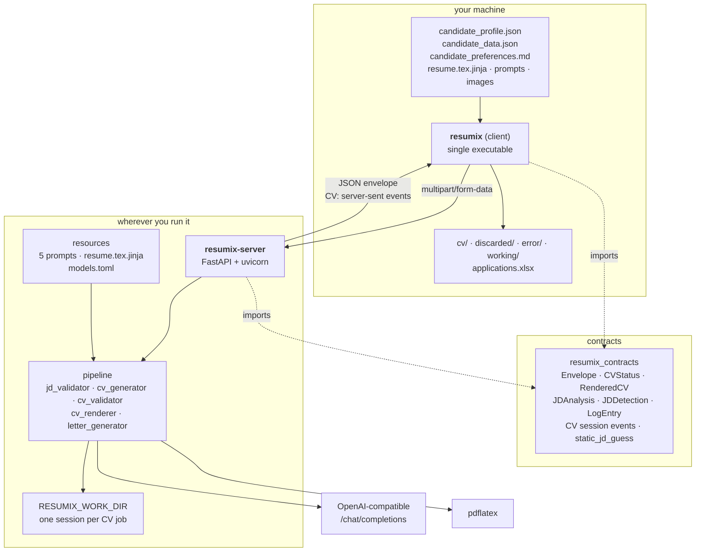
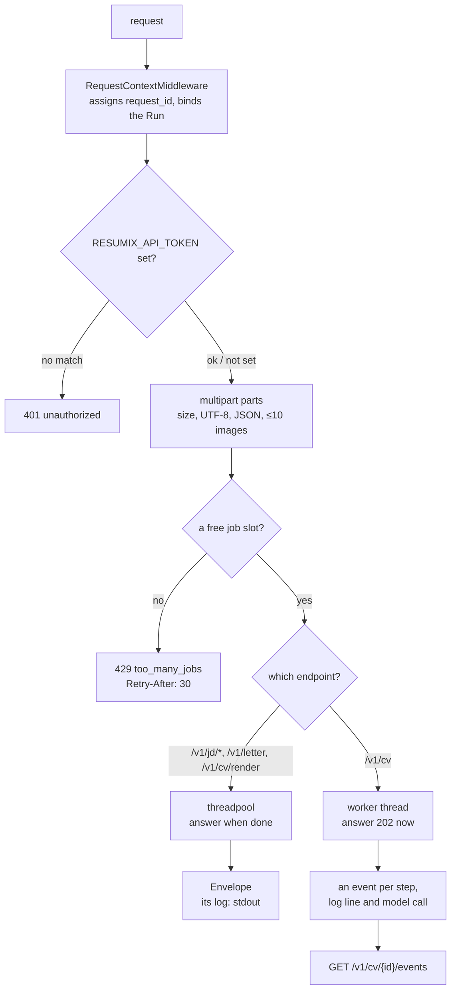

# Architecture

## The three packages



`client → contracts ← server`. Neither half imports the other, and
`tests/test_architecture.py` fails the build if one ever does. The contracts
package depends on pydantic and nothing else: it is loaded both by a web
server and by a frozen executable, and has to stay cheap in both.

| Package | Holds | Ships as |
|---|---|---|
| `client/` | Your profile, your contact data, your template and images, the output tree, the spreadsheet | A PyInstaller executable, ~1 file |
| `server/` | The provider API key, the five prompts, the LaTeX template, the LaTeX toolchain | A container image, ~780 MB |
| `contracts/` | The response envelope, the payload models, the free JD pre-check | A pydantic-only package, vendored into both |

## What crosses the wire

Everything personal arrives with the request. The server has no database, no
accounts and no seeded state; the only thing it keeps is a CV job's session,
one directory of events:

```text
$RESUMIX_WORK_DIR/<session id>/events/
    000001.json   {"type": "status", "data": {...}}
    000002.json   {"type": "log", "data": {...}}
    000003.json   {"type": "usage", "data": {...}}
    ...
    000042.json   {"type": "result", "data": {...}}   the CV: the last event
```

Each event is its own file, written once and never changed — which is what a
bucket mounted as a folder (OSS, Cloud Storage) can do: an object there cannot
be appended to, and a rename is a copy. A reader lists the directory and reads
what is new; the one file that may not read whole yet is the newest, so a
reader stops there and finds it complete on its next look. The session id is
the client's: the SHA-256 of the posting's text, so the same posting finds its
session again. A session is deleted when the client acknowledges it, or once
its last event is older than `RESUMIX_SESSION_TTL_DAYS`; a running one, never.
The scratch directory a job compiles in is on local disk, and is gone with the
job.

## Inside the server



`POST /v1/cv` for a session id that already has one skips the slot and the
thread: it answers `202` with `reattached: true`, and the caller follows the
events that are there.

- **One exception handler.** `describe_failure()` is the single place that
  decides what an exception produces on the wire, so a failure body has the
  same shape as a success: a `request_id`, `ok: false` and one line naming the
  kind and the stage. See [error model](protocol.md#errors).
- **One semaphore.** `RESUMIX_MAX_CONCURRENT_JOBS` (10) bounds requests in
  flight. A full server refuses immediately rather than queueing a caller for
  minutes.
- **The pipeline is a library.** Everything under `pipeline/` takes its inputs
  in memory and returns its outputs; it reads no configuration, resolves no
  paths and writes nothing outside the scratch directory it is handed. That is
  what makes it safe to run per request.
- **The LaTeX subprocess is sandboxed.** Shell escape off, reads and writes
  confined to the scratch directory, no stdin, a timeout, its own `HOME` and
  `TEXMFVAR`. A request may supply both the template and a whole `.tex`, so
  both are treated as hostile input.

## The six models

One provider, one API key, one endpoint — declared once in the `[provider]`
table of `resources/models.toml`. Six roles call it; a role that sets
`use_alternate_provider = N` (N ≥ 2) calls provider N instead — the
`[provider]` variable names with N appended (`MODEL_API_KEY2` /
`MODEL_BASE_URL2` for 2):

| Role | Used for | Shipped as |
|---|---|---|
| `detect` | JD detection: a one-word YES/NO on text that passed the free checks | `deepseek-v4.1-flash`, thinking **off**, 1000 max output tokens, temperature 0 |
| `analysis` | JD analysis; searches the web for the company evaluation | `qwen3.8-flash`, thinking on, max effort |
| `letter` | Cover letters; searches the web for the employer | `qwen3.8-flash`, thinking on, max effort |
| `cv` | Writing the CV | `qwen3.8-max-0902`, thinking on, 7500-token budget, strict JSON schema |
| `review` | Reviewing each CV against the master profile; answers in plain text, one violation per line, or `OK` | `deepseek-v4-pro-0813`, thinking on, 9000-token budget, temperature 0 |
| `highlight` | The `**bold**` keyword pass over validated CV JSON | `qwen3.8-flash`, thinking **off** |

Every call goes through `resumix_server.models`: one LangChain chat model per
role, built once at startup by the role's `model_provider` (`standard`, on
`ChatOpenAI`, or `deepseek`, on `ChatDeepSeek`), and one method,
`ModelSelector.call_llm(role, type, system_prompt, messages)`. It returns the
reply as a pydantic model, a `bool` (YES/NO) or a `str`, and retries a reply
that is empty, cut off or invalid — three calls in all, each retry told what
was wrong. Provider-specific request fields (`thinking_budget`,
`enable_search`) are the role's `extra_body`, sent as given: nothing checks a
combination against what the endpoint supports. Any key of a role can be
overridden with a `RESUMIX_<ROLE>_<FIELD>` environment variable without
editing the file; an empty value drops the key. The client's `temperature`
and `presence_penalty` reach only the `cv` role in a CV job and the `letter`
role in a letter job.

Every structured reply is validated by pydantic. Its schema reaches the model
once: in the request with `json_schema`, in the system prompt with
`json_mode`. A weak mode costs a retry, never correctness.

## Asynchrony, and why

Writing a CV takes minutes. `POST /v1/cv` answers `202` and hands the work to
a plain thread that outlives the response; the thread reports itself by
appending events to the session, and `GET /v1/cv/{id}/events` streams them —
everything so far, then each new one, until the last. A stream is a reader of
files, so it can be opened again at any time: after a dropped connection, with
`Last-Event-ID`, to get what it missed; after a client crash, from the start.
The client acknowledges the session (`DELETE`) only once the CV is stored.

The consequences are worth knowing before you deploy:

- **A running job lives in one instance.** Its events are files, so any
  instance sharing the work root can replay them, but only the instance that
  started it is writing them. Run one instance.
- **`WEB_CONCURRENCY=1`.** The slots and the workers are per-process, and a
  starting process ends every session that has not ended with a `503` error —
  correct for its own orphans, wrong for a sibling's live jobs.
- **A job cannot be cancelled yet.** An abandoned one holds a slot until its
  own budget runs out (`RESUMIX_REQUEST_BUDGET_SECONDS`, 20 minutes), and its
  session cannot be acknowledged until then.

## Observability

Every response carries a `request_id`, and so does the `X-Request-Id` header.
Every line the server logs to stdout carries it too.

A CV job streams its own account: every line it logged as a `log` event, every
model call as a `usage` event with its duration and token counts, and the
run's total in its last event — failed attempts included, because they were
paid for. The client writes all of it into `log.log` next to the CV. Nothing
else rides on a reply: for a detection, an analysis, a letter or a render, the
server's own log is where the commentary is.
