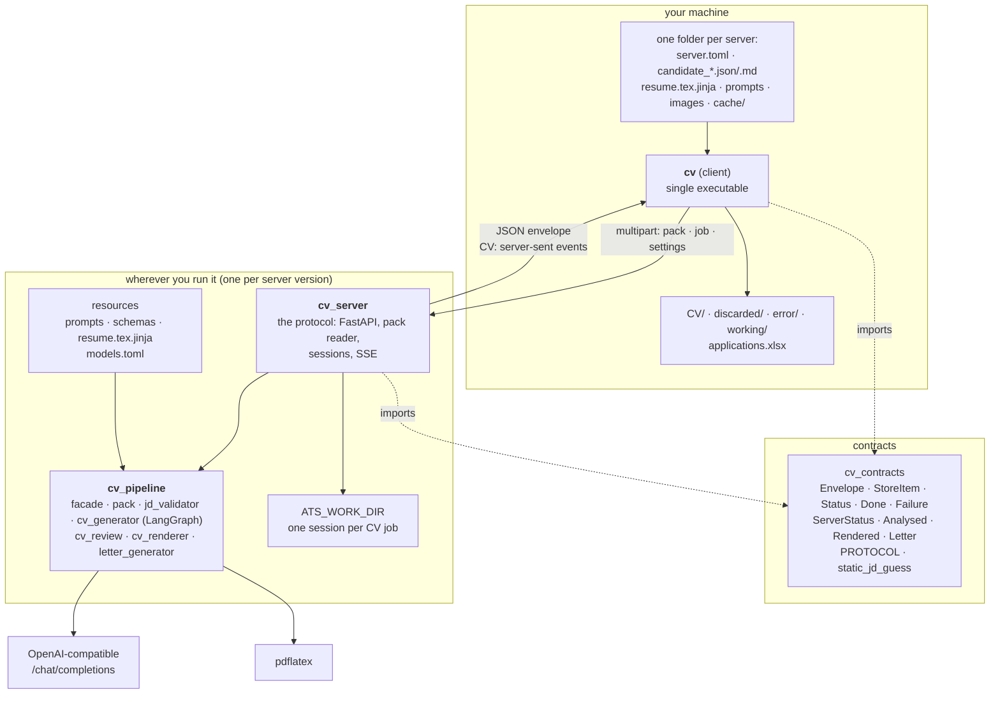
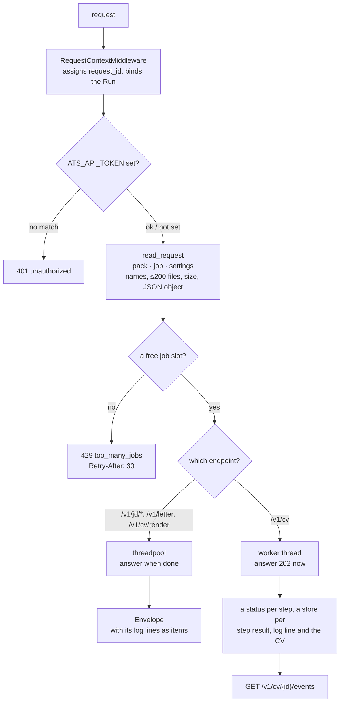

# Architecture

## The four packages



`client → contracts ← server → pipeline`. The client and the server never
import each other, the pipeline imports none of the others and knows no HTTP,
and the server reaches the pipeline only through its top level (`from
cv_pipeline import ...`); `tests/test_architecture.py` fails the build if any
of that breaks. The contracts package depends on pydantic and nothing else: it
is loaded both by a web server and by a frozen executable, and has to stay
cheap in both.

| Package | Holds | Ships as |
|---|---|---|
| `client/` | Your server folders — profile, contact data, template, images — the output tree, the spreadsheet | A PyInstaller executable, ~1 file |
| `server/` | The protocol: request reading, auth, sessions, the event stream | Inside the container image |
| `pipeline/` | Everything that makes a CV: the prompts and schemas, the models and their API keys, the LaTeX template and toolchain | Inside the container image, ~780 MB with TeX |
| `contracts/` | The wire format: the envelope, the payloads, a thing to store, the protocol number, the free JD pre-check | A pydantic-only package, vendored into client and server |

The wire knows no pipeline: the client sends a **pack** — every file of a
server folder — and stores what the server tells it to store. So one client
talks to a 0.5, a 1.x and a 2.0 server, side by side on one posting, and
`contracts/src` and `server/src` are the same files on every release line;
only `pipeline/` differs. See [the protocol](protocol.md).

## What crosses the wire

Everything personal arrives with the request, in the pack. The server has no
database, no accounts and no seeded state; the only thing it keeps is a CV
job's session, one directory of events:

```text
$ATS_WORK_DIR/<session id>/events/
    000001.json   {"type": "status", "data": {"status": "started", ...}}
    000002.json   {"type": "store", "data": {"type": "log", ...}}       a log line
    000003.json   {"type": "store", "data": {"type": "step", ...}}      a step's result
    ...
    000041.json   {"type": "store", "data": {"type": "cv", ...}}        the PDF
    000042.json   {"type": "done", "data": {...}}                       the last event
```

Each event is its own file, written once and never changed — which is what a
bucket mounted as a folder (OSS, Cloud Storage) can do: an object there cannot
be appended to, and a rename is a copy. A reader lists the directory and reads
what is new; the one file that may not read whole yet is the newest, so a
reader stops there and finds it complete on its next look. The session id is
the client's: the SHA-256 of the posting's text, so the same posting finds its
session again. A session is deleted when the client acknowledges it, or once
its last event is older than `ATS_SESSION_TTL_DAYS`; a running one, never.
The scratch directory a job compiles in is on local disk, and is gone with the
job.

## Inside the server



`POST /v1/cv` for a session id that already has one skips the slot and the
thread: it answers `202` with `reattached: true`, and the caller follows the
events that are there.

- **One exception handler.** `describe_failure()` is the single place that
  decides what an exception produces on the wire, so a failure body has the
  same shape as a success: a `request_id`, `ok: false` and one line naming the
  kind and the stage. See [error model](protocol.md#errors).
- **One semaphore.** `ATS_MAX_CONCURRENT_JOBS` (10) bounds requests in
  flight. A full server refuses immediately rather than queueing a caller for
  minutes.
- **The pipeline is a library.** `cv_pipeline` takes the pack, the job and the
  settings in memory and returns values, or hands its outputs to a sink; it
  resolves no paths and writes nothing outside the scratch directory it is
  handed. Its face is `Pipeline` (`detect`, `analyze`, `letter`, `cv`,
  `render`, `info`), and every expected failure leaves it as a
  `PipelineError` with a kind. The server reads `models.toml` and the
  environment through `Pipeline.build()`, once at startup. That is what makes
  it safe to run per request.
- **The LaTeX subprocess is sandboxed.** Shell escape off, reads and writes
  confined to the scratch directory, no stdin, a timeout, its own `HOME` and
  `TEXMFVAR`. A request may supply both the template and a whole `.tex`, so
  both are treated as hostile input.

## The models

One provider, one API key, one endpoint — declared once in the `[provider]`
table of `pipeline/resources/models.toml`. Every role calls it, except a role that sets
`use_alternate_provider = N` (N ≥ 2), which calls provider N instead — the
`[provider]` variable names with N appended (`MODEL_API_KEY2` /
`MODEL_BASE_URL2` for 2):

| Role | Used for | Shipped as |
|---|---|---|
| `detect` | JD detection: a one-word YES/NO on text that passed the free checks | `deepseek-v4.1-flash`, thinking **off**, 1000 max output tokens, temperature 0 |
| `analysis` | JD analysis; searches the web for distances and company facts | `qwen3.8-flash`, thinking on, max effort |
| `letter` | Cover letters; searches the web for the employer | `qwen3.8-flash`, thinking on, max effort |
| `jd_evaluation` | A CV's first step: the JD's key points, each with an importance | `deepseek-flash` on DeepSeek's API (provider 2), medium effort |
| `profile_scoring` | Each list of the profile scored against the key points | the same, high effort |
| `format_selection` | The CV format, the experiences shown and their duty caps | the same, medium effort |
| `cv` | Writing the CV body, and each experience on its own | the same, medium effort |
| `validation` | Checking the body and each experience against the profile, as `replace_in_*` tool calls | the same, medium effort |
| `highlight` | The `**bold**`/`*italic*` keyword pass over the validated CV | the same, medium effort |

See [the CV pipeline](cv-pipeline.md) for how the last six fit together.

Every call goes through `cv_pipeline.models`: one LangChain chat model per
role, built once at startup by the role's `model_provider` (`standard`, on
`ChatOpenAI`, or `deepseek`, on `ChatDeepSeek`), and two methods.
`ModelSelector.call_llm(role, type, system_prompt, messages)` returns the reply
as a pydantic model, a `bool` (YES/NO), a `str`, or a JSON `list` or `dict`;
`call_tools(role, tool, …)` returns the arguments of the tool calls the reply
made. Both retry a reply that is empty, cut off or invalid — three calls in
all, each retry told what was wrong. Provider-specific request fields
(`thinking_budget`, `enable_search`) are the role's `extra_body`, sent as
given: nothing checks a combination against what the endpoint supports. Any
key of a role can be overridden with a `ATS_<ROLE>_<FIELD>` environment
variable without editing the file; an empty value drops the key. A request's
`settings` can bring an `extra_body` for every role but `detect`, which
supersedes all of that role's settings for that request.

Every pydantic reply is validated. Its schema reaches the model once: in the
request with `json_schema`, in the system prompt with `json_mode`. A weak mode
costs a retry, never correctness. The CV steps reply with JSON their prompts
describe — the writer's two schemas are part of its input — and are parsed,
not validated.

## Asynchrony, and why

Writing a CV takes minutes. `POST /v1/cv` answers `202` and hands the work to
a plain thread that outlives the response; the thread reports itself by
appending events to the session, and `GET /v1/cv/{id}/events` streams them —
everything so far, then each new one, until the last. A stream is a reader of
files, so it can be opened again at any time: after a dropped connection, with
`Last-Event-ID`, to get what it missed; after a client crash, from the start.
The client acknowledges the session (`DELETE`) only once everything it
streamed is stored.

The consequences are worth knowing before you deploy:

- **A running job lives in one instance.** Its events are files, so any
  instance sharing the work root can replay them, but only the instance that
  started it is writing them. Run one instance.
- **`WEB_CONCURRENCY=1`.** The slots and the workers are per-process, and a
  starting process ends every session that has not ended with a `503` error —
  correct for its own orphans, wrong for a sibling's live jobs.
- **A job cannot be cancelled yet.** An abandoned one holds a slot until its
  own budget runs out (`ATS_REQUEST_BUDGET_SECONDS`, 20 minutes, read by the
  pipeline), and its session cannot be acknowledged until then.

## Observability

Every response carries a `request_id`, and so does the `X-Request-Id` header.
Every line the server logs to stdout carries it too.

A CV job streams its own account as things to store: every line it logged —
one per model call with its duration and token counts — each step's result,
and, as the last log line before the last event, the run's total — failed
attempts included, because they were paid for. An analysis, a letter or a
render reply carries its log lines the same way, as `items`. The client
writes the lines into `log.log` under the server's name, and each result into
that server's subfolder of the job.
