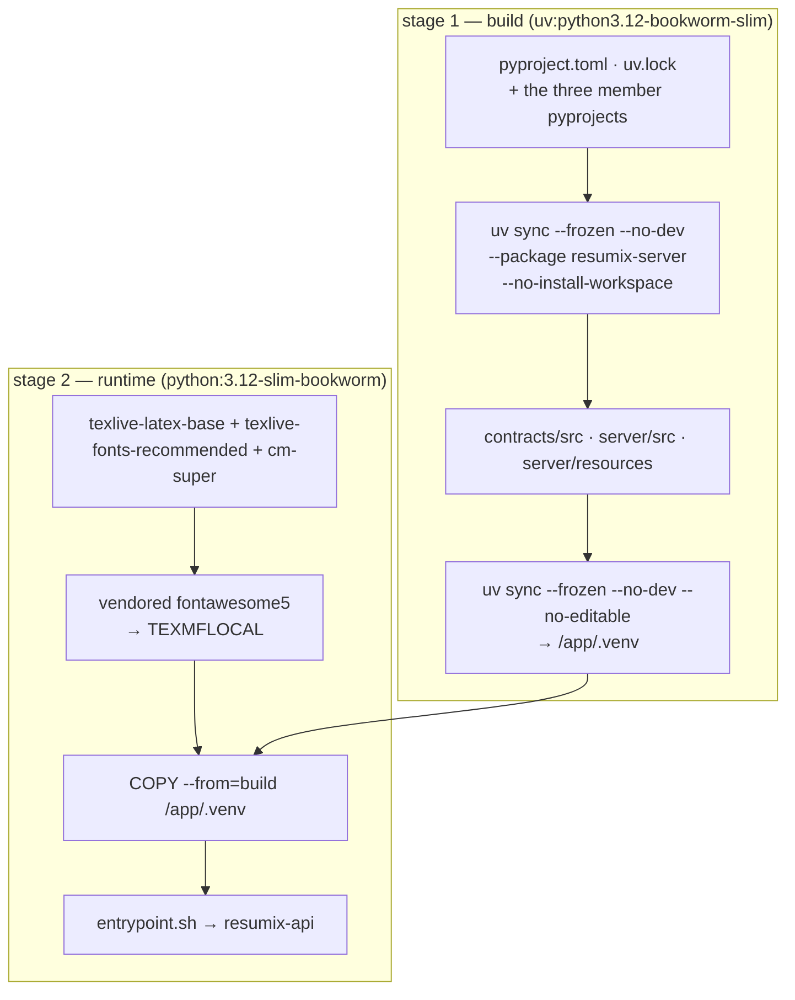

# Building the server

The server is a container image: a Python virtualenv, the LaTeX toolchain and
uvicorn. It mounts nothing and seeds nothing.

## Build it

```bash
cd <repo root>
DOCKER_BUILDKIT=0 docker build -t resumix-server .
```

**The `Dockerfile` lives at the repository root, not in `server/`**, because
some cloud builders refuse a Dockerfile in a subfolder. The build context is
the root: the image needs `contracts/` and `server/`, and nothing else.

**Classic builder only.** No BuildKit features and no heredocs — CI builds
with `DOCKER_BUILDKIT=0` on purpose, and the image must stay buildable that
way.



Why the layers are in that order: the lock file changes rarely and the code
changes every commit, so dependencies resolve in a layer of their own.
`--no-editable` copies the packages into the venv instead of linking them back
to `/app/src`, so the runtime stage needs nothing but the venv.

### What the LaTeX bits are for

| Package | Why |
|---|---|
| `texlive-latex-base` | `hyperref`, `graphicx`, `array`, `hhline`, `amsmath`, `babel-english` — everything `resume.tex.jinja` uses |
| `texlive-fonts-recommended` | The font files behind psnfss (Charter, Times, Palatino, ...). The stock template does not need them; a template of your own that loads `\usepackage{charter}` does |
| `cm-super` | Type 1 CM fonts. Without them, T1 encoding falls back to bitmap fonts and the PDF looks scanned. `cm-super-minimal` is not enough: it leaves the design sizes the CV uses for headings and small print as Type 3 bitmaps |
| `fontawesome5` (vendored) | The contact icons in the CV header. Debian ships it only inside the 1.7 GB `texlive-fonts-extra`, so it is vendored as a TeX Live archive in `server/docker/vendor/` and unpacked into `TEXMFLOCAL`. No network access during the build |

The image is ~780 MB, almost all of it that toolchain.

## Run it

```bash
docker run --rm -p 8080:8080 --env-file .env resumix-server
curl localhost:8080/healthz          # expect "pdflatex": true
```

It runs as any uid (`--user "$(id -u):$(id -g)"`), needs no volume, and works
with a read-only root filesystem as long as `/tmp` is writable **and
executable**:

```bash
docker run --read-only --tmpfs /tmp:exec -p 8080:8080 --env-file .env resumix-server
```

`exec` on that tmpfs is required: `pdflatex` writes and then reads back its
font cache there. A tmpfs also means a CV session does not survive a restart —
mount a volume, or a bucket, at `RESUMIX_WORK_DIR` if you want it to.

`server/compose.yaml` does all of the above with the settings already wired:

```bash
cp .env.example .env     # then fill in one provider's API key
cd server && docker compose up --build
```

The published image is on Docker Hub:

```bash
docker run -d -p 8080:8080 -e MODEL_API_KEY=... \
  -e MODEL_API_KEY2=... -e MODEL_BASE_URL2=https://api.deepseek.com lmstch/resumix:latest
```

`:latest` and `:x.y.z` are pushed by the release workflow, not by hand — see
[Cutting a release](release.md). Pin the version tag if you want the server to
stay where the client you handed out expects it.

## Configure it

### The provider

Three model roles, one provider, one API key. The endpoint is declared once in
the `[provider]` table of `resources/models.toml`; the key comes from the
environment.

```bash
MODEL_API_KEY=sk-...
MODEL_BASE_URL=https://dashscope-intl.aliyuncs.com/compatible-mode/v1
```

Any OpenAI-compatible endpoint works — OpenAI, OpenRouter, DeepSeek, a local
Ollama. Switching providers is replacing those two values; `models.toml`
names the same two variables and does not need to change.

A model that sets `use_alternate_provider = 2` calls a second endpoint,
from `MODEL_API_KEY2` / `MODEL_BASE_URL2`, instead; `3` uses
`MODEL_API_KEY3` / `MODEL_BASE_URL3`, and so on. The shipped six CV steps all
use `2`, DeepSeek's own API (`https://api.deepseek.com`): the server builds
every role at startup and does not start without those two.

Per-role overrides need no rebuild either — `RESUMIX_<ROLE>_<FIELD>`, for any
key of a role, for `DETECT`, `ANALYSIS`, `LETTER`, `JD_EVALUATION`,
`PROFILE_SCORING`, `FORMAT_SELECTION`, `CV`, `VALIDATION` and `HIGHLIGHT`:

```bash
RESUMIX_CV_MODEL=qwen-max
RESUMIX_CV_TEMPERATURE=0.2
RESUMIX_CV_THINKING=off            # auto | on | off
RESUMIX_CV_REASONING_EFFORT=high   # any string the provider accepts
RESUMIX_CV_API=responses           # chat_completions | responses
RESUMIX_CV_MODEL_PROVIDER=deepseek # standard | deepseek
RESUMIX_CV_EXTRA_BODY={"thinking_budget": 4000}   # JSON; replaces the whole table
RESUMIX_CV_USE_ALTERNATE_PROVIDER=2  # MODEL_API_KEY2 / MODEL_BASE_URL2
RESUMIX_LETTER_TEMPERATURE=        # empty sends no temperature (OpenAI's reasoning models reject one)
RESUMIX_LETTER_EXTRA_BODY={}       # no enable_search, for an endpoint without DashScope's
```

Nothing checks a combination against what the endpoint supports: what a role
declares is what is sent. The comments in `models.toml` list the known traps.

### Environment

| Variable | Default | What it does |
|---|---|---|
| `MODEL_API_KEY` | — | The provider key. Without it the server does not start |
| `MODEL_BASE_URL` | DashScope intl. | The OpenAI-compatible endpoint |
| `MODEL_API_KEY<N>` / `MODEL_BASE_URL<N>` | — | Key/endpoint N (2, 3, …), for models with `use_alternate_provider = N`. As shipped, 2 is required: DeepSeek, for the CV steps |
| `PORT` / `HOST` | `8080` / `0.0.0.0` | Where uvicorn listens |
| `WEB_CONCURRENCY` | `1` | uvicorn worker processes. **Keep it at 1** per work root |
| `RESUMIX_KEEPALIVE` | `75` | uvicorn keep-alive timeout, seconds |
| `RESUMIX_API_TOKEN` | unset | Bearer token clients must send. **Unset means no auth** |
| `RESUMIX_RESOURCES` | baked in | Directory of replacement prompts / template / `models.toml` |
| `RESUMIX_WORK_DIR` | system temp | Where CV sessions are kept, one directory of events each. Scratch space is always local temp |
| `RESUMIX_SESSION_TTL_DAYS` | `1` | Days a session nobody acknowledged is kept after its last event |
| `RESUMIX_MAX_CONCURRENT_JOBS` | `10` | Requests in flight; the rest get `429` |
| `RESUMIX_LATEX_TIMEOUT` | `120` | Seconds before a compile is killed |
| `RESUMIX_REQUEST_BUDGET_SECONDS` | `1200` | Wall clock for one CV run before `504`, checked before each step |
| `RESUMIX_MAX_PART_BYTES` | `2000000` | Cap on any one uploaded part |
| `RESUMIX_JD_MIN_CHARS` / `_MAX_CHARS` | `500` / `30000` | Length band for the free JD check |
| `RESUMIX_LOG_LEVEL` | `INFO` | Logging level |

### Prompts and the template

The five prompts and `resume.tex.jinja` ship inside the image. To change them
permanently, mount a directory with your versions and set
`RESUMIX_RESOURCES`; anything missing there falls back to the built-in copy.
To change them for one request, upload them as parts — that is what the client
does when it finds them next to its executable.

```bash
docker run -p 8080:8080 --env-file .env \
  -v "$PWD/my-resources:/resources:ro" -e RESUMIX_RESOURCES=/resources \
  resumix-server
```

## From a checkout

```bash
uv sync
uv run resumix-api            # http://localhost:8080
uv run pytest server/tests      # no API key, no network
uv run pytest                   # every package, plus the integration test
```

The LaTeX-dependent tests skip themselves when `pdflatex` is absent. Nothing
in the suite calls a model: `server/tests/server_helpers.py` wires a real
`ModelSelector` to a fake HTTP transport, so request assembly, structured
output, retries and usage logging are all the production code paths.
`server/tests/golden/cv_golden.tex` pins the whole render — an escaping
regression is otherwise invisible until someone reads a bad PDF.

## Deploying

A CV job runs for minutes after the request that started it has been answered.
That is the one thing to plan around.

- **`RESUMIX_WORK_DIR` is state.** Every CV session lives there until the
  client acknowledges it, or until its last event is older than
  `RESUMIX_SESSION_TTL_DAYS`. The default is the system temp directory, which
  on most container platforms is RAM-backed and empty again after a redeploy.
  Mount a volume — or a bucket, as `server/terraform` does on Alibaba Cloud —
  to have sessions outlive the instance. Each event is a file written once,
  which a bucket mounted as a folder can do.
- **One process per work root.** The job slots and the worker threads are
  per-process, and a starting process ends every session that has not ended
  with a `503` — right for its own orphans, wrong for a sibling's live jobs.
- **A CV's stream lasts as long as its job.** Every other call returns in
  seconds; only `/v1/cv/render` waits on a compile. A platform request timeout
  has to outlast `RESUMIX_REQUEST_BUDGET_SECONDS` plus the round in flight;
  the client reconnects after a cut, but some platforms restart the instance
  on a timeout.
- **Size for the compiles, not the waiting.** Ten jobs in flight is the
  default; each is mostly idle on the provider — up to ten calls at once,
  for the steps that score or write one item each — but each also compiles
  LaTeX once, or a few times when it has to be trimmed.
- **Scaling.** A running job lives in the instance that started it: run one
  instance.
- **Cold starts** build an HTTP client per model role and read the prompts.
  Fast — but the first request also warms the LaTeX font cache in `/tmp`.

### Sandboxing

A request may supply the LaTeX template, and `/v1/cv/render` accepts a whole
`.tex`. That is arbitrary LaTeX, so every compile runs with shell escape
disabled (`-no-shell-escape`, `shell_escape=f`), reads and writes confined to
the scratch directory (`openin_any=p`, `openout_any=p`), no stdin to block on,
a timeout, and its own `HOME`/`TEXMFVAR`. The scratch directory is deleted
when the request ends, and the scratch path is scrubbed out of any LaTeX log
that goes back to a client.

## In CI

`.github/workflows/ci.yml` has three jobs. The `image` one builds with
`DOCKER_BUILDKIT=0`, starts the container with a deliberately invalid provider
endpoint, and asserts `/healthz` reports `"pdflatex":true` — the image is
checked for the toolchain, not for a model.

`.github/workflows/release.yml` builds it the same way — classic builder,
`linux/amd64` — and adds one assertion before it pushes: that `/healthz`
reports the version being released. The server reads its version from the
installed package metadata, which the image builds with `--no-editable`, so
that check is what proves the number on the Docker Hub tag is the number the
container will report.
