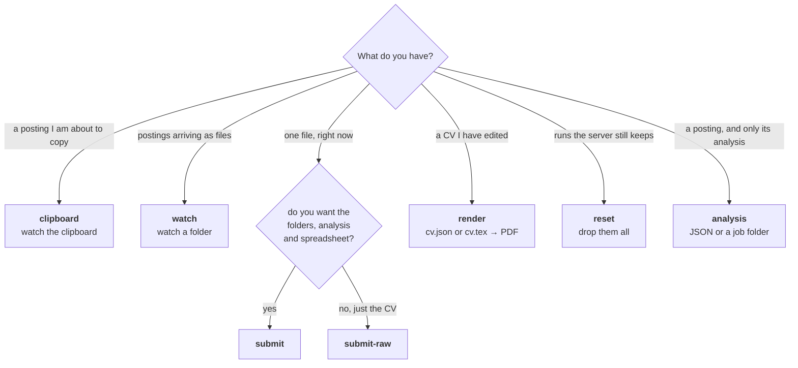
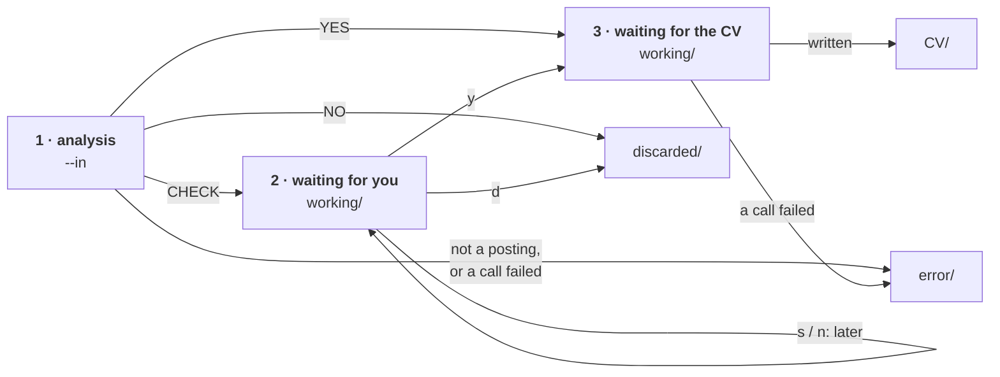

# The client

One executable, eight modes. It keeps your CV data on your machine and sends it,
per request, to the servers that hold the model API keys and the LaTeX
toolchain. No Python, no API key and no LaTeX install of your own.

It talks to any server that speaks [protocol 2](protocol.md) — a 0.5, a 1.x,
a 2.0 — and to several at once: each writes its own CV of the same posting,
side by side, into the same job folder. The client knows nothing about any of
them but where they are: it sends each one its own folder of files and keeps
what it is told to keep.

```text
cv [global options] MODE [mode options]
```

Global options work on either side of the mode name: `cv -v submit
posting.txt --out ~/applications` and `cv submit -v …` do the same
thing.

## Which mode



| Mode | Asks before spending | Detects + analyses | Writes the folder tree | Spreadsheet | Cover letter |
|---|---|---|---|---|---|
| `clipboard` | yes (or `--yes`) | yes | yes | yes | optional |
| `watch` | CHECK postings only (none with `--yes`) | yes | yes | yes | optional |
| `submit` | yes (or `--yes`) | yes | yes | yes | optional |
| `submit-raw` | **no** | no | no | no | no |
| `analysis` | **no** | analyses only | no | no | no |
| `render` | no — costs no model call | no | no | no | no |
| `reset` | no — costs no model call | no | no | no | no |

## The modes

### `clipboard` — copy a posting, get a CV

```bash
cv clipboard --out ~/applications
```

Watches the clipboard. When you copy something that looks like a posting, it
checks with the server, analyses it, prints the analysis and asks — every
posting, whatever its `should_apply` says:

```text
Paste the posting URL to submit, y = submit without link, n/s = skip, q = quit
> https://jobs.example.com/12345
```

- `y`, or the posting URL: its CV is queued and the clipboard is watched
  again at once. CVs are written in the background, one at a time per server,
  while you read the next posting; their lines are tagged with the job's
  folder name (`[Acme_Corp_Head_of_IT] …`) and held back while a question is
  on screen.
  The URL is stored in `analysis.json` and goes to the spreadsheet.
- `n` or `s`: it is filed under `discarded/`.
- `q`: clipboard mode stops. The posting stays in `working/`, marked
  `PENDING` in its `approval_status.txt`, and is asked about again at the
  next start — never decided by its `should_apply`.

**Stopping.** `q` also works while nothing is being asked: the CV being
written is finished, and the approved ones still queued wait in `working/`
for the next start. Ctrl-C stops at once.

**Startup.** Anything left in `working/` by a previous run is offered back to
you first: *resume*, *clean* or *quit*. Resume sends each folder where its own
files say — the table under `watch`'s *Startup*: approved ones go straight to
the CV writer, and the ones still waiting for an answer are asked about
before anything new is read.

With `--yes` nothing is asked: every posting is submitted, and so is every
leftover waiting for an answer.

On Linux the clipboard needs a helper — `apt install xclip` (X11) or
`wl-clipboard` (Wayland) — and a reachable `DISPLAY`/`WAYLAND_DISPLAY`. The
client probes it at startup and tells you if it cannot read it, instead of
waiting forever for a change that can never arrive. Over SSH, forward X11 or
use `watch`, which needs no clipboard at all.

### `watch` — drop files into a folder

```bash
cv watch --in ~/Downloads/postings --out ~/applications
```

Each posting goes through four stages, and the analysis decides the route:
`should_apply` YES gets its CV without a question, CHECK waits for you, NO is
put aside. The CVs are written in the background, one at a time per server,
while you read the next posting.



What you can drop:

- **A `.txt` file** — the posting, read as UTF-8 text. It has to look like a
  posting (the local check, then the server's), otherwise it lands in
  `error/` with a `.log` beside it. Once its analysis is filed, the file is
  deleted from `--in`. Any other file — a PDF, a `.docx` — goes to `error/`
  with nothing sent: paste its text into a `.txt`.
- **A folder** holding `jd.txt` and a valid `analysis.json` — one from `CV/`,
  `discarded/` or `error/`, for instance. Detection and analysis are skipped:
  it is copied into `working/` under its company and title, removed from
  `--in`, and goes where its own files say (the table under *Startup*). One
  that already holds its CVs is sent to each server with what that server
  stored there (`v11/cv.json`, …), and the server renders it again — one
  LaTeX compile, no model call, and no new spreadsheet row, because a
  `cv_*.pdf` was already there. A folder with no `jd.txt`, or whose
  `analysis.json` does not validate, goes to `error/` with a `log.log` inside
  saying why.

Names starting with `.` are ignored, and anything still being copied in is
left alone until it stops changing.

**When a posting needs you** (CHECK), you see its text, then the analysis,
and answer:

```text
y = write the CV (or paste the posting URL), d = discard, s/n = next, q = quit
> https://jobs.example.com/12345
```

- `y`, or the posting URL: its CV is queued. The URL is stored in
  `analysis.json` and goes to the spreadsheet.
- `d`: it is filed under `discarded/`.
- `s` or `n`: it is asked again after the others.

Your answer is kept in the folder as `approval_status.txt` — `APPROVED` or
`DISCARDED` (`clipboard` and `submit` also write `PENDING` while they wait for
yours). Anything typed before a posting was on screen is thrown away, so
a stray `y` never approves one you have not read, and what the inbox and the
CV writer print is held back until you have answered.

**Stopping.** `q` works at any time, also when nothing is waiting for you:
nothing new is started, the posting being analysed and the CV being written
are finished, then the watcher exits. Ctrl-C stops at once; the next start
picks up whatever was running, and a posting still in `--in` is read again.

**`--yes`** asks nothing: YES postings get their CV, NO postings are
discarded, and CHECK postings wait in `working/` for a run without `--yes`.

**Startup.** Whatever an earlier run left in `working/` goes where its own
files say, before anything new is read. The rules are tried in this order:

| The folder holds | It goes to |
|---|---|
| no `jd.txt`, or no valid `analysis.json` | `error/` |
| no `approval_status.txt` | by `should_apply`: YES to the CV queue, CHECK to you, NO to `discarded/` |
| `approval_status.txt` saying `APPROVED` | the CV queue |
| `approval_status.txt` saying `DISCARDED` | `discarded/` |
| `approval_status.txt` saying `PENDING` | you: asked about again, whatever `should_apply` says |
| `approval_status.txt` saying anything else | `error/` |

A folder dropped into `--in` follows the same table. What it already holds
does not change where it goes: each server is sent its own subfolder and
decides from it — its `cv.json` is rendered, else its `cv.tex` compiled,
else the CV is written. A folder from an older client, with its CV at the top
level and no server subfolder, is written again (and paid for). To retry a job
that failed, move its folder from `error/` back into `--in`; to have a CHECK
posting written without being asked, set its `approval_status.txt` to
`APPROVED` first. A loose file left in `working/` by an older version goes to
`error/`: move it back into `--in` to have it read again.

`--in` defaults to `./incoming`, created if missing. It may not be the same
folder as `--out`, and the watcher has to be allowed to delete from it.

### `submit` — one file, once

```bash
cv submit posting.txt --out ~/applications --yes
```

The same steps as `clipboard`, for a single file: analysed, asked about
(unless `--yes`), and the CVs written right there, one server after the
other — the command returns once the folder is filed. No recovery prompt: a one-off run must not start by asking about
someone else's leftovers. The file you name is **read**, never moved — unlike
`watch`, which empties the folder it watches. `q` at the question leaves the
posting in `working/` as `PENDING`, to be asked about at the next start of
`clipboard` or `watch`.

```bash
cv submit posting.txt analysis.json --out ~/applications
```

With an `analysis.json` for the posting — from an earlier run's folder, say —
detection and analysis are skipped and it goes straight to the CV; you are
still asked first, unless `--yes`. Both are copied into the job folder as
`jd.txt` and `analysis.json`, so the analysis you passed is the one delivered
beside the CV. One that does not validate stops the command before anything is
sent or written.

### `submit-raw` — just the CV, right here

```bash
cv submit-raw posting.txt
cv submit-raw posting.txt -o cv.pdf -o cv.json -o cv.tex
```

The CV and nothing else: no detection, no analysis, no question before
spending, no cover letter, no spreadsheet, no folders. Files land in the
directory you are standing in. It is written by the default server, or by the
one `--server_ver` names.

`-o` is repeatable and the suffix is the whole instruction — `.pdf` writes the
PDF, `.json` the `cv.json` the server stored, `.tex` its `cv.tex`. A name you chose is overwritten
without asking, because a name you chose is a name you meant. With no `-o` you
get one PDF named after the posting (`posting.txt` → `posting.pdf`), and a
second run counts up to `posting_1.pdf` rather than replacing it.

### `analysis` — just the analysis

```bash
cv analysis --in posting.txt
cv analysis --in posting.txt --output-format folder
```

The analysis and nothing else: no detection, no question, no CV. It is made
by the default server, or by the one `--server_ver` names — then the default
is not used at all. That server folder needs `candidate_profile.json` and
`candidate_preferences.md`, and it costs one model call. With `--output-format json` (the default) the analysis is printed on
stdout — nothing else is, so it pipes straight into `jq`. With `folder` it
writes `<Company>_<Title>/` holding `jd.txt` and `analysis.json` into `--out`,
which defaults to `incoming/` under `--data-dir` (or the current folder): the
shape `watch` takes from its input folder, and the folder it watches by
default. A folder of the same name is replaced. It is written as
`.<Company>_<Title>/` and renamed once both files are in, so a `watch` running
on it never picks up half a job. Failures go to stderr.

### `render` — compile an edited CV

```bash
cv render ~/applications/CV/26-01-15/Acme_Head_of_IT/v11/cv.json
cv render ~/applications/CV/26-01-15/Acme_Head_of_IT/v05/cv.tex --server_ver v05 --output /tmp/preview.pdf
```

Give it a `.json` document to render from the content, or a `.tex` to compile
a hand-edit: it is sent as `cv.json` or `cv.tex` by its suffix, with the
default server's folder (or the `--server_ver` one), so the template and the
images are the ones that server would use today. Only the PDF is kept: it
lands next to the input unless `--output` says otherwise. Costs one LaTeX
compile and no model call. A failed render prints the end of the TeX log,
which says where the LaTeX breaks.

### `reset` — drop what the server keeps

```bash
cv reset
```

Every CV is a session on the server, kept until the client has saved its
files (see [A CV that was interrupted](#a-cv-that-was-interrupted)). `reset`
deletes every session the default server still has — or each `--server_ver`
one's — except one whose CV is still being written, and says how many it
deleted. After it, every posting is written from scratch.

### `version` — which build is this

```bash
cv version
```

Prints `version x.y.z`, then asks the default server — or each `--server_ver`
one — for its version and its protocol, and says whether they can talk: a
server on another protocol is one the client refuses to talk to, and `cv
version` exits 1. The client's line is printed first and never depends on the
rest, so it answers even when the configuration is wrong or a server is down;
the server line then says it was not checked, and the exit code stays 0. Every `--verbose` run prints the first line
at startup, which is what you want in a bug report.

The number comes from the package metadata bundled into the executable, so it
is the version the release workflow built — there is no string in the source to
forget to bump.

## Several servers

Without `--server_ver`, only the default server writes CVs. With it — once or
more on `watch`, `clipboard` and `submit` — the named servers write one each,
and the default still analyses every posting, once:

```bash
cv watch --server_ver v11 --server_ver v05
```

Each server has a CV queue and a thread of its own, so the two CVs of a
posting are written side by side (`submit` writes them one after the other).
The folder is delivered once every server has finished or failed: to `CV/`
when at least one wrote its CV — the failure is in `log.log` and in the exit
code — and to `error/` when none did. The spreadsheet row points at the
default server's PDF when there is one, else at the first one written.

`analysis`, `render` and `submit-raw` take a single `--server_ver`, which
replaces the default. `reset` and `version` take several. A name that is not
in `cv.toml`'s `servers` stops the client before anything starts.

## Postings you have seen before

Before anything is spent on a posting, every `analysis.json` under `CV/`,
`discarded/` and `working/` is read back. A posting is the same job when its URL matches, or
when its company *and* title match — case, accents and spacing ignored. A side
without a URL is compared by company and title only; one without a company or
title, by URL only. Old files are read as they are, never validated: one that
cannot be read is skipped.

The check runs as soon as a posting is analysed, before you are asked, in
every mode. A posting already applied to, discarded or still in flight prints
`already applied`, `already discarded` or `already in progress` with the
earlier folder, and is dropped: nothing is asked and nothing is written. The
mode carries on: the clipboard keeps waiting, `submit` exits. In `watch`, a
posting with a `JOB_POSTING: <url>` line is checked by that URL before
anything is sent, LinkedIn ids included: one already known is deleted from the
inbox with the same message, and costs no call at all.

A posting that is dropped leaves nothing behind: the earlier copy already
holds it. So to redo one, *move* the earlier folder out of `CV/` or
`discarded/` first — before you copy the posting again, and instead of
copying a folder you drop back into `watch`.

## A CV that was interrupted

A CV is a session on the server, named after the posting's text. While the CV
is written the client follows it, printing each step and storing everything
the server sends — each step's result, each line it logs, what each model call
cost, the total, the PDF; once everything is stored, the client tells the
server, which deletes the session. Anything in between costs nothing:

- **A dropped connection** is picked up again on its own, from the last thing
  received.
- **A client that died** — a closed laptop, Ctrl-C, a crash: run the same
  posting again, with `submit`, `submit-raw`, `clipboard` or `watch`, and the
  server replays the run from the start, still going or already finished,
  instead of writing a new CV. `↺ this posting already has a run on the
  server` says so.
- **`--new`** drops that run and writes the CV again: for when you changed your
  profile, your template, a prompt or a `[settings]` value, none of which
  change the posting's text. It is refused while the old run is still being written.

A session nobody came back for is kept for a day (the server's
`ATS_SESSION_TTL_DAYS`), and `cv reset` drops them all.

## Options

### Global

| Flag | What it does |
|---|---|
| `--config FILE` | Use this `cv.toml` instead of looking for one. |
| `--data-dir DIR` | The folder that holds `cv.toml`. Default: the current folder. |
| `-v`, `--verbose` | Print `version x.y.z` at startup, then what each server reports about each finished step — what it produced, tokens, thinking tokens, elapsed — every line it logs (one per model call, and the `Σ` total), the CV's session id and the `/healthz` attempts. |

### Per mode

| Flag | Modes | What it does |
|---|---|---|
| `--server_ver NAME` | clipboard, watch, submit, reset, version | A server folder listed in `cv.toml`. Repeatable: each one named writes its own CV (or is reset, or checked). Default: the default server. `--server-ver` is the same flag. |
| `--server_ver NAME` | analysis, render, submit-raw | Once: the server to use instead of the default. |
| `--out DIR` | clipboard, watch, submit | The output folder (`working/`, `error/`, `discarded/`, `CV/`). Default: the current folder. |
| `--in DIR` | watch | The folder to watch. Default: `./incoming`, created if missing. |
| `--in FILE` | analysis | The posting to analyse. Required. |
| `--output-format json\|folder` | analysis | `json`: print the analysis on stdout. `folder`: write `<Company>_<Title>/` with `jd.txt` and `analysis.json` into `--out`, replacing one of the same name. Default `json`. |
| `--out DIR` | analysis | Where `--output-format folder` writes. Default: `<data-dir>/incoming`, created if missing. |
| `--cover-letter no\|yes\|letter_only` | clipboard, watch, submit | Also write a cover letter, or write *only* one. The default server writes it. Default `no`. |
| `--yes` | clipboard, watch, submit | Submit every valid posting without asking. Unattended runs spend tokens on their own. A posting already applied to, discarded or in flight is skipped, still without asking. In `watch` it only stops the questions: YES postings get their CV, NO postings are discarded, CHECK postings wait in `working/` for a run without `--yes`. |
| `--no-xlsx` | clipboard, watch, submit | Do not record delivered CVs in the spreadsheet. |
| `--new` | clipboard, watch, submit, submit-raw | Write each CV again even when the server still has a run for the same posting, which is otherwise replayed. Refused while that run is still being written. |
| `-o FILE` | submit-raw | Write one output here: `.pdf`, `.json` or `.tex`. Repeatable. |
| `--output FILE` | render | Where to write the PDF. Default: beside the input. |

Exit code is `0` when nothing failed, `1` when a posting failed on any server
or the client could not start (a missing server folder, an unreachable server,
a bad config).

## Configuration

Your data folder holds the client, its `cv.toml`, the output folders and one
folder per server:

```text
gab/                               the data folder: where cv.toml is
  cv(.exe)   cv.toml
  incoming/  working/  error/  discarded/  CV/  applications.xlsx
  v11/                             a server folder, listed in cv.toml
    server.toml
    candidate_profile.json  candidate_data.json  candidate_preferences.md
    candidate_signature.png  sys_prompt_*.txt  resume.tex.jinja  ...
    cache/                         the server's own; sent with every request
  v05/ ...
```

A flag beats `cv.toml`. Nothing about a server is in `cv.toml`, and nothing
about the client is in a server folder.

### `cv.toml`

Looked for as `--config`, then `$ATS_CONFIG`, then `cv.toml` in `--data-dir`
(the current folder by default).

```toml
servers      = ["v11", "v05"]     # server folders, relative to this file
default_server = "v11"            # analyses postings, writes the letter; optional with one server
cover_letter = "no"               # no | yes | letter_only
verbose      = false              # same as -v on every run
```

Every listed folder is read at start, used or not: a missing folder or
`server.toml`, a `default_server` or `--server_ver` that is not listed,
or no default for a mode that needs one, stops the client before anything
starts.

### `server.toml`

One in each server folder. A server's name is its folder's name.

```toml
url     = "https://ats-strike.example.run.app"
token   = "the-bearer-token"      # only if the server requires one
timeout = 1800                    # seconds to follow one CV job

[settings]                        # sent as is; what it means is the server's
pages = 2
[settings.extra_body.cv]          # a 1.x setting
temperature = 0.4
```

Exactly one listed server is the default: it analyses every posting, in every
mode, and writes the cover letter. `[settings]` is forwarded to the server
untouched with every request, so its keys are whatever that server reads. On a
1.x server: `pages` (the page limit the CV must fit, default 2) and
`extra_body.<role>` — what one model role runs on instead of the server's
`models.toml` settings, all of them, not just the keys you set. The 1.x roles
are the CV's steps — `jd_evaluation`, `profile_scoring`, `format_selection`,
`cv`, `duties`, `validation`, `highlight` — and `analysis` and `letter`. A 0.5
server reads `pages`, `temperature` and `presence_penalty`.

`server.toml` holds the token, so like `cv.toml` it is git-ignored.

### A server folder

Every file in it except `server.toml` is sent with every request to that
server, sub-folders included, under its path relative to the folder — and
only that server's folder: nothing is taken from anywhere else, so each one
is self-contained. What a file is for is the server's business; the 1.x
server reads these (the 0.5 server reads its own prompt set):

| File | What it is | Needed |
|---|---|---|
| `candidate_profile.json` | Everything you have ever done. The models tailor the CV from this — the more complete, the better. Its `experiences` each need an `id` and `duties`. | **yes** |
| `candidate_data.json` | Name, email, phone, LinkedIn, languages, location, education. Printed by the template as-is; no model is shown it. Its `name` also names your PDFs. | **yes** |
| `candidate_preferences.md` | What you want from a job, in prose. Scored against each posting. | for analysis |
| `resume.tex.jinja` | Your own LaTeX template. | no — the server's is used |
| `sys_prompt_jd_evaluation.txt`, `sys_prompt_profile_scoring.txt`, `sys_prompt_format_selection.txt`, `sys_prompt_cv_body.txt`, `sys_prompt_cv_duties.txt`, `sys_prompt_validation_body.txt`, `sys_prompt_validation_duties.txt`, `sys_prompt_highlight.txt`, `sys_prompt_letter.txt`, `sys_prompt_analysis.txt` | Your own prompts. | no — same |
| `cv_body_schema.json`, `cv_duties_schema.json` | Your own JSON schemas for the CV body and for an experience: the writer is shown them, so a field you add here and in your template reaches the page. | no — same |
| `*.png`, `*.jpg`, `*.jpeg` | Images, under their own file name — the name your template includes them under. `candidate_signature.png` is just one such image: the stock template includes it, and the server has a blank one if you do not. | no |
| `cache/` | The server's own store: where it keeps things between requests. Leave it alone. | — |

Start from the fictional set in the repository's `examples/candidate/`, and
from `client/cv.toml.example` and `client/server.toml.example`.

### Moving from an older client

There is no migration command; it is a few files to move by hand. In your data
folder:

1. Make a server folder, `v11/` say, and move into it
   `candidate_profile.json`, `candidate_data.json`,
   `candidate_preferences.md`, every image, and any `sys_prompt_*.txt`,
   `*_schema.json` or `resume.tex.jinja` of yours — the files `[files]`
   named too.
2. Write `v11/server.toml`: `url` from `server_url`, `token`, `timeout`, and under `[settings]` your `pages` and each
   `[extra_body.<role>]` table as `[settings.extra_body.<role>]`.
3. Cut `cv.toml` down to `servers = ["v11"]` (add `default_server = "v11"` once
   you list a second one), `cover_letter` and `verbose`.

`--server`, `--token`, `--pages`, `ATS_API_URL` and `ATS_API_TOKEN` are gone.
Delivered job folders stay as they are: one dropped back into `watch` is
written again rather than rendered, because its CV is not in a server
subfolder.

### Environment

| Variable | What it does |
|---|---|
| `ATS_CONFIG` | Path to `cv.toml`. Beaten by `--config`. |

## Job folders

```text
~/applications/
├── CV/
│   └── 26-01-15/
│       └── Acme_Corp_Head_of_IT/
│           ├── cv_jordan_rivera_head_of_it.pdf       the default server's CV
│           ├── cv_jordan_rivera_head_of_it_v05.pdf   any other server's: its name at the end
│           ├── analysis.json            match score, salary, skills, gaps
│           ├── jd.txt                   the posting, whatever the file was called
│           ├── approval_status.txt      your answer, when you were asked
│           ├── cover_letter.txt         with --cover-letter
│           ├── log.log                  every step, and each server's own lines
│           ├── v11/                     what v11 stored: cv.json, cv.tex,
│           │                            steps/*.json, the images cv.tex includes
│           └── v05/                     what v05 stored
├── discarded/26-01-15/…                 postings you said no to, analysis kept
├── error/26-01-15/…                     rejected or failed, with a .log beside it
├── working/                             in flight, or waiting for you
└── applications.xlsx                    one row per delivered posting
```

File names come from `name` in the server folder's `candidate_data.json` and
the analysis' job title, not from the server. Where each thing a server sends
lands, for server `S` with folder `F`:

| What the server sends | Where it goes |
|---|---|
| a log line | `log.log`, as `  S <line>` |
| a step (`cv.json`, `cv.tex`, `steps/…`) | `<job>/S/<name>` |
| the CV | `<job>/cv_<you>_<title>.pdf` for the default server, else `…_S.pdf` |
| a cache file | `F/cache/<name>` |
| a cache log line | appended to `F/cache/log.log` |
| anything this client does not know, or a name that would leave its folder | skipped, with a line in `log.log` |

After the PDF, the server folder's top-level images are copied into `<job>/S/`
too, so `cv.tex` there compiles by hand. A server is sent `jd.txt`,
`analysis.json` and everything in its own subfolder — which is how a folder
that already holds its CV is rendered rather than written again.

To revise a CV: edit `<job>/v11/cv.json` and run `cv render` on it — one
LaTeX compile, no model calls. Editing the `.tex` and rendering that works
too. The spreadsheet's own header row is the schema: rename, reorder or add
columns in your copy and the rows follow.

`log.log` holds the client's steps, and every line each server logged for the
job — the analysis, the CV as it streamed in, the letter — under the server's
name:

```text
2026-01-15T09:30:12 ✍ v11: writing the CV (this takes minutes)...
2026-01-15T09:30:12    started
2026-01-15T09:30:12    jd_evaluation
  v11 2026-01-15T09:30:33+00:00 INFO    [cv.jd_evaluation]   ⏱ [jd_evaluation] deepseek-flash 21.2s | input=1847, thinking=7256, output=832, …
2026-01-15T09:30:33    profile_scoring
…
  v11 2026-01-15T09:35:24+00:00 INFO    [run] Σ 21 model call(s), 961.4s | input=64148, thinking=161200, output=14091
2026-01-15T09:35:25 v11: CV Path: cv_jordan_rivera_head_of_it.pdf
```

One line per model call is what it cost, and the `Σ` line is the whole run —
failed attempts included. The steps that make several calls make them at
once, so the calls' seconds add up to more than the run took. With two
servers, each one's lines come as a block when it finishes.

`steps/` holds what each step handed the next one, as the 1.x server streamed
it: the posting's key points, your profile with its scores and the evidence
for them, the format chosen and why, the CV before and after validation, and
the highlighted CV. A CV that failed half-way keeps the steps it finished,
under `error/`.

## What leaves your machine

Per request, to each server: the posting text and, for a job folder, its
`analysis.json` and what that server stored for the job; and every file of
that server's folder but `server.toml` — your `candidate_profile.json`,
`candidate_preferences.md`, `candidate_data.json`, every image, prompt and
template you put there, and its `cache/`. So keep nothing in a server folder
you would not send to that server. Whether *the model provider* keeps what it is shown
is between you and whoever runs the server — the same question as with any
hosted model.

**No model is ever shown your `candidate_data.json`.** It is sent because the
server compiles the CV to count its pages, and a page count taken with the
contact block missing is not the page count of the CV you will send; it goes
to the LaTeX template and nowhere else.

Nothing at all is sent for text that fails the local length and binary checks,
so a copied password or a screenful of code never leaves the machine. The
server keeps a CV's session — what the job logged and the finished CV — until
the client has saved the files, or for a day at most, and keeps nothing else.

## Troubleshooting

| What you see | What to do |
|---|---|
| `cannot reach the ats-strike server at …` | The server is down or the URL is wrong. `curl <url>/healthz` to check. |
| `did not come up after 3 attempts` | The server was unreachable on three tries two seconds apart — a cold container may need longer; try again. |
| `401` / `a valid bearer token is required` | The server wants a token: set `token` in its `server.toml`. |
| `speaks protocol 1, this client speaks protocol 2` | That server is too old for this client (or too new): update one of them. `cv version` checks without sending anything. |
| `file 'candidate_profile.json' is required` | Put it in that server's folder: the client sends nothing from anywhere else. |
| `no default_server is set in cv.toml` / `default_server v20: no such server` | With more than one server listed, `cv.toml` must name one of them in `default_server`. |
| `--server_ver v20: no such server` | The name is a folder listed in `cv.toml`'s `servers`. |
| `no clipboard here: neither DISPLAY nor WAYLAND_DISPLAY…` | Install `xclip` or `wl-clipboard`, or use `watch`. |
| `429` / `all job slots are busy` | The server is at capacity. Try again shortly. |
| `[clipboard] ✗ not a job description (412 chars, nothing sent)` | What you copied is a fragment. Nothing was sent anywhere. |
| A posting you wanted lands in `error/` | Read the `.log` beside it. A wrong "not a job description" verdict usually means the copy grabbed only part of the page. |
| A folder you dropped lands in `error/` | It needs `jd.txt` and a valid `analysis.json`. The `log.log` inside it says which was missing. |
| You need more than the error line | Its `log.log` has every line each server logged for the job, under the server's name. Beyond that, the server's own log has it under the request id the error names. |
| `working/` is not empty | A previous run stopped mid-job, a CV was still queued when you pressed `q`, or a posting waits for your answer (CHECK, or `PENDING`). `watch` picks everything up by itself at startup (see its *Startup* table); `clipboard` offers to resume or clean. |
| The client died but the job was running | Run the same posting again: the server replays the run instead of writing a new CV. `--new` writes it again. |
| `this posting's CV is still being written on the server` | `--new` cannot drop a run that is still going. Run without it to follow that run, or wait until it has finished. |
