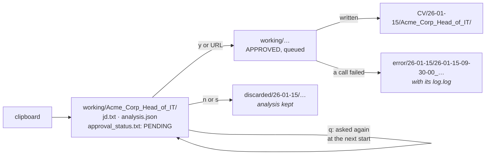

# A run, end to end

One posting, from the moment you press Ctrl+C on a job ad to the folder that
holds the PDF. This is `cv clipboard` with one server, the default. `submit`
runs the same steps once, for one file, and writes the CV on the main thread
before it returns. `watch` reads postings from a folder and asks only about
the CHECK ones — see [the client guide](client.md). With `--server_ver` the
default still does the detection, the analysis and the letter, and each named
server writes its CV on a thread of its own (see
[several servers](client.md#several-servers)).

## The call sequence

```mermaid
sequenceDiagram
    autonumber
    actor You
    participant Lis as Listener
    participant In as Intake
    participant Api as HttpApi
    participant Srv as default server
    participant Wp as WorkingProcessor
    participant Gen as CV thread

    Note over Lis: reads the clipboard every 2 s,<br/>listens for q in between

    You->>Lis: copy a posting
    Lis->>In: take(text)
    In->>In: static_jd_guess(text)
    Note right of In: too short, too long or binary<br/>→ printed and dropped, nothing sent

    In->>Api: detect(job: jd.txt)
    Api->>Srv: GET /healthz
    Note right of Api: once per client, 3 attempts, 2 s apart;<br/>another protocol → refused
    Srv-->>Api: 200 ServerStatus
    Api->>Srv: POST /v1/jd/detect
    Srv-->>Api: 200 {is_job_description}
    Note right of In: false → dropped here

    In->>Api: analyze(pack, job, settings)
    Api->>Srv: POST /v1/jd/analysis
    Srv-->>Api: 200 {analysis, items}
    In->>Wp: hold(text, analysis)
    Note right of Wp: applied, discarded or in flight<br/>→ "already …", nothing written
    Wp-->>In: working/Acme_Corp_Head_of_IT/ (PENDING)

    In->>You: print the analysis, ask
    You-->>In: URL · y · n/s · q
    Note right of In: n/s → discarded/<br/>q → stays PENDING, and stop
    In->>Wp: approve(folder, url)
    Wp->>Gen: queued for its CV
    In-->>Lis: back to the clipboard at once

    Gen->>Api: create_cv(pack, job, settings, id)
    Api->>Srv: POST /v1/cv, X-Request-Id: sha256(jd.txt)
    Srv-->>Api: 202 {reattached}

    Gen->>Api: events(id)
    Api->>Srv: GET /v1/cv/{id}/events
    loop until the last event
        Srv-->>Api: status · store
        Gen-->>You: [Acme_Corp_Head_of_IT] each status (detail and log lines with -v)
        Gen->>Gen: each item where it belongs: v11/steps/…, log.log, the PDF
    end
    Srv-->>Api: done {detail}
    Gen->>Api: acknowledge(id)
    Api->>Srv: DELETE /v1/cv/{id}

    opt --cover-letter yes
        Gen->>Api: letter(pack, job, settings)
        Api->>Srv: POST /v1/letter
        Srv-->>Api: 200 {text, items}
        Gen->>Gen: cover_letter.txt
    end

    Gen->>Wp: finished(folder, v11)
    Wp->>Wp: the last server to finish: log.log, then move → CV/day/Company_Title/
    Wp->>Wp: one row in applications.xlsx
```

## The same run, as state on disk



A job is assembled under `working/` and moved into place in one step when it
is finished, so a folder under `CV/` is never half-written. `Workspace` owns
every path and every move; `WorkingProcessor` is the only thing that asks it
to make one.

## Step by step

**1 — The free check runs on your machine.** `static_jd_guess` lives in
`contracts/` precisely so both sides run the same one: the client uses it
before spending a network call, the server before spending a model call.
Copying a password or a line of code never reaches the network, and the
terminal says so: `[clipboard] ✗ not a job description (412 chars, nothing sent)`.

**2 — `/healthz` before the first real call.** A freshly started server (a
cold container, a scale-to-zero platform) can take a moment to answer, so the
client knocks up to three times, two seconds apart, once per server — not
once per call. With `-v` it narrates the attempts. A server that speaks
another protocol is refused there and then.

**3 — Detection costs one small model call.** `POST /v1/jd/detect` answers
`{"is_job_description": true|false}`. *Why* something was rejected is in the
server's log for that request, not in the answer — a caller only ever branches
on the verdict. A false verdict on a posting you wanted usually means the copy
grabbed only part of the page.

**4 — Analysis creates the folder, unless the posting was seen before.** The
analysis comes back as the server wrote it, an opaque JSON object, with its
log lines for the folder's `log.log`. Its company name and job title are what
the folder is named after, so the folder cannot exist before the analysis
does. First every
`analysis.json` under `CV/`, `discarded/` and `working/` is compared with the
new one: a posting already applied to, discarded or still in flight is
dropped with the earlier folder's path, and nothing is written. Otherwise
`jd.txt`, `analysis.json` and `approval_status.txt` saying `PENDING` are
written at once.

**5 — The question is the only thing standing between you and the bill.**
Everything before it costs one or two small model calls; everything after it
costs minutes of the large one. You are asked about every posting, whatever
its `should_apply` says. Answer with the posting URL and it is stored in
`analysis.json` (and in the spreadsheet); `y` submits without one; `n` or `s`
files it under `discarded/`; `q` stops, and leaves the posting `PENDING` in
`working/`. `--yes` answers for you, with the URL the analysis found if it
found one.

**6 — The CV is written in the background.** Saying yes writes `APPROVED` and
queues the folder on every server's queue; each server's CV thread takes one
folder at a time, and the clipboard is read again at once, so you read the next posting while the last
one's CV is written. Its lines are tagged with the folder's name, and held
back while a question is on screen. `q` between postings lets the CV being
written finish; the approved ones still queued stay in `working/`.

**7 — The CV job is a session the client follows.** `POST /v1/cv` sends the
server folder (the pack), the posting with what that server stored for it
before (the job), and its `[settings]`, and returns `202` at once, under a
session id that is the SHA-256 of the posting's text. The client then reads
the session's events as the server writes them: each new status, printed;
with `-v`, each step's `detail` too, and every log line — one per model call,
with its cost. Every `store` item is kept as it arrives: each step's result
in the server's subfolder (`v11/steps/…`, `v11/cv.json`, `v11/cv.tex`), each
log line in `log.log`, the PDF at the top of the folder. The last log line is
what the whole run cost; once `done` arrives, everything is written, and the
client acknowledges the session and the server deletes it.

If the connection drops, the client opens the stream again from the last
event it got. If the client dies mid-job, the job does not: the server keeps
writing the session. Run the same posting again and the server answers with
the session it already has — replayed from the start, nothing paid twice.
`--new` drops it and writes the CV again.

**8 — The next start picks up where this one stopped.** Anything left in
`working/` is offered back at startup: *resume*, *clean* or *quit*. Resume
sends each folder where its own files say: `APPROVED` to the CV threads,
`PENDING` to you before anything new is read. A folder that already holds a
server's `cv.json` sends it with the job, and that server renders it instead
of writing a new CV — one LaTeX compile, no model call.

**9 — Failure is filed, not printed and lost.** A CV job that fails ends its
session with an `error` event — the cause, after the log line saying what the
attempts cost — and everything the server logged for it is already in
`log.log`; the client acknowledges the session. When no server wrote its CV,
the job moves to `error/`; when another did, it is delivered and the failure
stays in `log.log` and in the exit code. Any other call that
fails carries a `request_id`, written into the log and printed: the server's
own log has that request's lines under it.

**10 — The spreadsheet is bookkeeping, never a reason to fail.** A locked or
broken `applications.xlsx` becomes a warning line in `log.log`; the CV was
paid for and stays delivered.

## Where each step lives in the code

| Step | Module |
|---|---|
| Reading the clipboard | `client/src/cv_client/sources/clipboard.py` |
| The loop: leftovers first, then the clipboard, `q` | `client/src/cv_client/stages/listener.py` |
| The free check, detection, analysis | `client/src/cv_client/stages/analysis.py` |
| The question | `client/src/cv_client/stages/intake.py`, `client/src/cv_client/ui.py` |
| The duplicate check, every move, the queues | `client/src/cv_client/stages/working.py` |
| Where a folder goes next | `client/src/cv_client/stages/jobfolder.py` |
| Writing the CV, one at a time per server | `client/src/cv_client/stages/generation.py`, `client/src/cv_client/cvjob.py` |
| The server folders | `client/src/cv_client/servers.py`, `client/src/cv_client/config.py` |
| The threads, `q` and Ctrl-C | `client/src/cv_client/stages/watcher.py` |
| Every HTTP call, and nothing else | `client/src/cv_client/api.py` |
| Paths, moves, where each stored item goes | `client/src/cv_client/workspace.py` |
| `log.log` | `client/src/cv_client/joblog.py`, `client/src/cv_client/stages/terminal.py` |
| `applications.xlsx` | `client/src/cv_client/tracking.py` |
