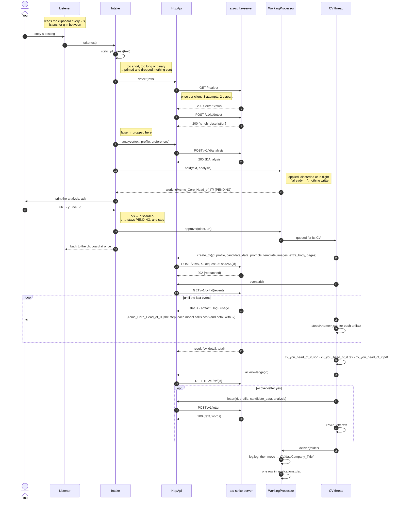
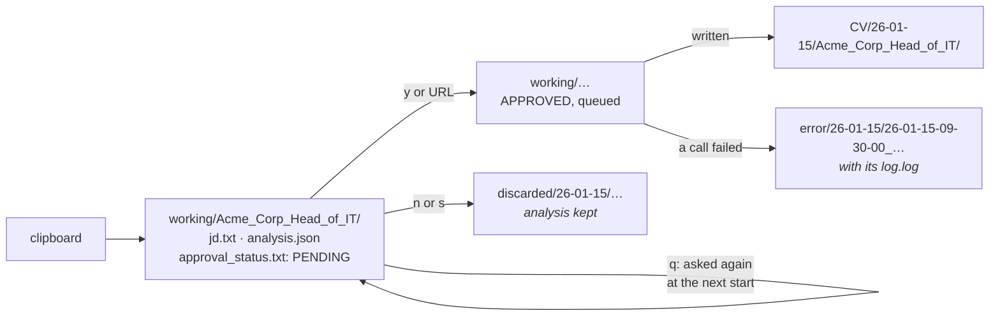

# A run, end to end

One posting, from the moment you press Ctrl+C on a job ad to the folder that
holds the PDF. This is `cv clipboard`. `submit` runs the same steps once,
for one file, and writes the CV on the main thread before it returns. `watch`
reads postings from a folder and asks only about the CHECK ones — see
[the client guide](client.md).

## The call sequence

## The same run, as state on disk

A job is assembled under `working/` and moved into place in one step when it
is finished, so a folder under `CV/` is never half-written. `Workspace` owns
every path and every move; `WorkingProcessor` is the only thing that asks it
to make one.

## Step by step

**1 — The free check runs on your machine.** `static_jd_guess` lives in
`contracts/` precisely so both sides run the same one: the client uses it
before spending a network call, the server before spending a model call.
Copying a password or a line of code never reaches the network, and the
terminal says so: `[clipboard] ✗ not a job description (412 chars, nothing sent)`.

**2 — `/healthz` before the first real call.** A freshly started server (a
cold container, a scale-to-zero platform) can take a moment to answer, so the
client knocks up to three times, two seconds apart, once per process — not
once per call. With `-v` it narrates the attempts.

**3 — Detection costs one small model call.** `POST /v1/jd/detect` answers
`{"is_job_description": true|false}`. *Why* something was rejected is in the
server's log for that request, not in the answer — a caller only ever branches
on the verdict. A false verdict on a posting you wanted usually means the copy
grabbed only part of the page.

**4 — Analysis creates the folder, unless the posting was seen before.** The
company name and job title in the `JDAnalysis` are what the folder is named
after, so the folder cannot exist before the analysis does. First every
`analysis.json` under `CV/`, `discarded/` and `working/` is compared with the
new one: a posting already applied to, discarded or still in flight is
dropped with the earlier folder's path, and nothing is written. Otherwise
`jd.txt`, `analysis.json` and `approval_status.txt` saying `PENDING` are
written at once.

**5 — The question is the only thing standing between you and the bill.**
Everything before it costs one or two small model calls; everything after it
costs minutes of the large one. You are asked about every posting, whatever
its `should_apply` says. Answer with the posting URL and it is stored in
`analysis.json` (and in the spreadsheet); `y` submits without one; `n` or `s`
files it under `discarded/`; `q` stops, and leaves the posting `PENDING` in
`working/`. `--yes` answers for you, with the URL the analysis found if it
found one.

**6 — The CV is written in the background.** Saying yes writes `APPROVED` and
queues the folder; the CV thread takes one folder at a time, and the
clipboard is read again at once, so you read the next posting while the last
one's CV is written. Its lines are tagged with the folder's name, and held
back while a question is on screen. `q` between postings lets the CV being
written finish; the approved ones still queued stay in `working/`.

**7 — The CV job is a session the client follows.** `POST /v1/cv` returns
`202` at once, under a session id that is the SHA-256 of the posting's text.
The client then reads the session's events as the server writes them: each
new step, printed; what each model call cost, printed; with `-v`, each step's
`detail` too — what the step that just finished produced, and its token
spend. Each step's result goes into the folder's `steps/`, as JSON, and every
line the server logs for the job into `log.log`. The last event holds the
document, the LaTeX and the PDF, and what the whole run cost; once those are
written, the client acknowledges the session and the server deletes it.

If the connection drops, the client opens the stream again from the last
event it got. If the client dies mid-job, the job does not: the server keeps
writing the session. Run the same posting again and the server answers with
the session it already has — replayed from the start, nothing paid twice.
`--new` drops it and writes the CV again.

**8 — The next start picks up where this one stopped.** Anything left in
`working/` is offered back at startup: *resume*, *clean* or *quit*. Resume
sends each folder where its own files say: `APPROVED` to the CV thread,
`PENDING` to you before anything new is read, and a folder that already holds
its document (`cv_you_head_of_it.json`) is posted to `/v1/cv/render` instead
of starting a job — one LaTeX compile, no model call.

**9 — Failure is filed, not printed and lost.** A CV job that fails ends its
session with an `error` event — the cause, and what the attempts cost — and
everything the server logged for it is already in `log.log`; the client
acknowledges the session and moves the job to `error/`. Any other call that
fails carries a `request_id`, written into the log and printed: the server's
own log has that request's lines under it.

**10 — The spreadsheet is bookkeeping, never a reason to fail.** A locked or
broken `applications.xlsx` becomes a warning line in `log.log`; the CV was
paid for and stays delivered.

## Where each step lives in the code

| Step | Module |
|---|---|
| Reading the clipboard | `client/src/cv_client/sources/clipboard.py` |
| The loop: leftovers first, then the clipboard, `q` | `client/src/cv_client/stages/listener.py` |
| The free check, detection, analysis | `client/src/cv_client/stages/analysis.py` |
| The question | `client/src/cv_client/stages/intake.py`, `client/src/cv_client/ui.py` |
| The duplicate check, every move, both queues | `client/src/cv_client/stages/working.py` |
| Where a folder goes next | `client/src/cv_client/stages/jobfolder.py` |
| Writing the CV, one at a time | `client/src/cv_client/stages/generation.py`, `client/src/cv_client/cvjob.py` |
| The threads, `q` and Ctrl-C | `client/src/cv_client/stages/watcher.py` |
| Every HTTP call, and nothing else | `client/src/cv_client/api.py` |
| Paths, moves | `client/src/cv_client/workspace.py` |
| `log.log` | `client/src/cv_client/joblog.py`, `client/src/cv_client/stages/terminal.py` |
| `applications.xlsx` | `client/src/cv_client/tracking.py` |
