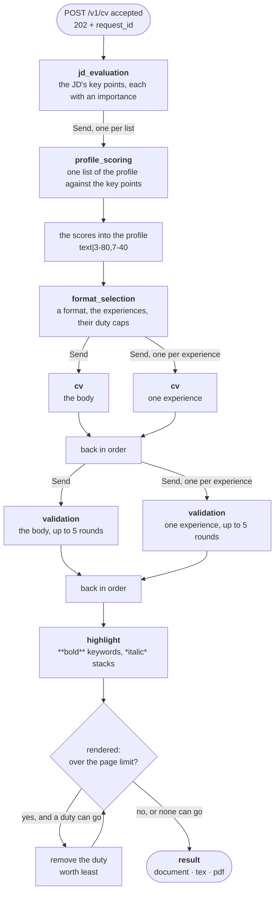

# The CV pipeline

What `POST /v1/cv` does with the minutes it takes: six steps, each on a model
of its own, then a render that trims the CV until it fits. The method is the
one adapticv-ai worked out.

The code is `server/src/cv_server/pipeline/cv_generator.py`
(`CVGenerator`, the steps as a LangGraph graph), `cv_review.py` (the
validation loop) and `cv_renderer.py` (the compile and the page count).

## The steps



| Step | Calls | Shown | Hands over |
|---|---|---|---|
| `jd_evaluation` | 1 | the JD | `key_points`: 6 to 15 requirements, each with keywords and an importance from 0 to 100 |
| `profile_scoring` | one per list of the profile — 9 for the example candidate | the key points, one list, and its experience when the list is inside one | `scored_profile`, `score_reasons` |
| `format_selection` | 1 | the key points, the formats, the scored experiences | `format_selection`: the format, the experiences shown, the duties of each, and why |
| `cv` | 1 for the body, 1 per experience shown | the key points, the writing style, the schema, the scored profile or experience, its duty cap and its evidence | `cv_body`, `cv_experiences` |
| `validation` | 1 to 5 per document | the writing style, the round, the profile or the experience without scores, the generated text, the replacements that failed | `checked_body`, `checked_experiences` |
| `highlight` | 1 | the key points, the CV the models wrote, the evidence | `highlighted_resume` |

Each step has its own role in [`models.toml`](build-server.md#the-provider);
`cv` and `validation` each serve two prompts, the body's and the
experiences'. Each step's result is streamed to the client as it is ready,
and stored beside the CV under `steps/`.

**Scores.** `profile_scoring` gives every item of the profile the key points
it matches, at most four, each scored 0–100 for how completely the item proves
it: a string becomes `Led the migration.|3-80,7-40` (key point 3 at 80, key
point 7 at 40), an object gets a `"score": "3-80,7-40"` field. The words that
prove each match stay out of the profile, in `score_reasons`; the writer and
the highlighter are shown them as EVIDENCE. The scores ride along to the end
and come off at the render.

**Coverage.** A key point counts its two best duty scores, up to twice its
importance (`COVERAGE_BEST`, `COVERAGE_CAP`): a duty on a key point already
covered adds nothing, and weak matches cannot fill a key point before its
strong ones. The duties prompt says the same in words, and the trim below
uses the same rule.

**Formats.** What `format_selection` chooses from, and what the trim keeps:

| Format | Experiences | Duties each | Duties in all |
|---|---|---|---|
| A | 3 | 3–8 | 22 |
| B | 4 | 2–6 | 17 |
| C | 5 | 1–4 | 13 |

The code assumes nothing about the CV or the profile beyond the work
experiences (each with an `id` and its `duties`), their duties and the
`writing_style`: the prompts and the template decide everything else.

## Side by side

A step that makes several calls fans them out with LangGraph's `Send`: one
node per profile list, per experience, and they run at the same time. Each
writes its answer, tagged with its position, into a list the graph collects;
a node in code puts the answers back in profile order before the next step
starts. The steps themselves run one after another.

The parallel nodes run in the job's own context, so their log lines and their
token counts land in the job's session like any other. A call that fails —
three unusable replies, an endpoint that refuses — fails the job with its own
cause and stage, after the calls beside it have finished.

## Validation

The validators check facts and grammar against your profile, with minimal
edits; style is the writers' business. Each violation comes back as a call of
a tool — `replace_in_body` or `replace_in_duties` — which is only a schema:
the code applies the replacement, in the order the calls came, and asks
again. A round with no call ends the review. A replacement whose text is not
found goes back to the model as a FAILED REPLACEMENT. After five rounds
(`MAX_VALIDATIONS`) the CV goes on with the last edits: a CV with a doubtful
line in it is worth more to you than an error.

The validators count no pages. The page limit is the render's business alone.

## The render

After the highlight the CV is rendered — your `candidate_data` merged over
the top, the scores removed — and its pages are counted. While it runs past
the page limit (`pages`, 2 by default), one duty goes: of the experiences with
more duties than the format's minimum, the duty whose removal loses the
fewest coverage points; on a tie, the one with the lowest total score, then
the older experience's. Then it is rendered again. When no duty can go, the
longer CV is delivered.

Every render is of the merged document, so every page count is the page
count of the CV you will send. **That is why the endpoint takes
`candidate_data`.** No model is ever shown it: the highlighter sees what the
models wrote, and your data goes over the top at the render, so a field a
model invents can never replace a real name, email or address.

The renders before the last stay in the job's scratch directory. Only the
final PDF is sent, in the result.

## Retries, budgets and what each failure costs

| Guard | Limit | Set by | On exhaustion |
|---|---|---|---|
| Calls per model request (empty, cut off, or not the JSON asked for) | 3 | `ATTEMPTS` in `models/selector.py` | `502 model_output`, except for the highlight |
| Highlight | the same | the same | a warning; the CV is delivered unmarked |
| Validation rounds per document | 5 | `MAX_VALIDATIONS` in `pipeline/cv_review.py` | the CV goes on with the last edits |
| Wall clock for the whole run | 1200 s | `ATS_REQUEST_BUDGET_SECONDS` | `504 budget_exceeded`, checked before each step |
| One `pdflatex` compile | 120 s | `ATS_LATEX_TIMEOUT` | `504 latex_timeout` |

A reply that is JSON is parsed and its type checked — a list or an object —
and nothing more, as adapticv-ai does: no schema is enforced. A reply whose
items do not line up with what was asked (fewer scores than items) fails the
job.

## What the client sees while it runs

The job's session streams a `status` event as each step starts, with one line
about the step that just finished: what it produced, and its tokens, thinking
and time. Between them come an `artifact` event with each step's result, as
the JSON it is, and the `log` and `usage` events that say what each model
call did and cost.

```json
{"status": "cv",
 "detail": "format A: experiences [0, 1, 2], duties [8, 8, 6], tokens used=4210, thinking=1952, elapsed=24.3s"}
```

The render belongs to the `highlight` step: it takes a second or a few.

The session ends with a `result` event — the document, its LaTeX and its PDF,
and what the whole run cost — or, for a job that failed, an `error` event
with the status and cause the work produced (`502`, `504`, `422`) and what it
cost anyway. Either way it is the last thing the stream carries.

## Changing it for one request

Every prompt and both schemas the writer is shown can be replaced by a part
of the same name: `sys_prompt_jd_evaluation`, `sys_prompt_profile_scoring`,
`sys_prompt_format_selection`, `sys_prompt_cv_body`, `cv_body_schema`,
`sys_prompt_cv_duties`, `cv_duties_schema`, `sys_prompt_validation_body`,
`sys_prompt_validation_duties`, `sys_prompt_highlight`. So can the template
and its images. The prompts and schemas are what the models read: editing one
changes what they write.

Each step's model settings can be replaced too: `<step>_extra_body`, a JSON
object, supersedes every setting `models.toml` gives that step — temperature,
thinking, reasoning effort, the output cap, its own `extra_body` — and only the
model, the endpoint and what you sent go out.

## What comes back

The `result` event's `cv` is `{document, tex, pdf_base64}`.

`document` is one flat object: what the models wrote, without the scores,
with your `candidate_data` merged **over the top**. It has no schema of its
own — what the template reads from it is between you and the template. Store
it, edit it, and post it back to `POST /v1/cv/render`, which costs one LaTeX
compile and no model call.

## Rendering

`render_document()` is pure up to the compile: the document is escaped for
LaTeX (including turning `**bold**` into `\textbf{}` and `*italics*` into
`\textit{}`), `generation_date` is added — so re-rendering yesterday's file
dates it today — and Jinja fills the template. The Jinja delimiters are
LaTeX-safe: `\VAR{}`, `\BLOCK{}`, `\#{}`.

Images sent with the request are written next to the `.tex` under exactly the
file name the part carried, because `\includegraphics` resolves relative to
it. One `pdflatex` pass, not two: the shipped template has no `\ref`,
`\label` or `\tableofcontents`, so a second pass would change nothing.

## The other three pipelines

None has a loop. Each runs on its own model: `detect`, `analysis` and `letter`.

- **`jd_validator.detect`** — the free structural checks first (length band,
  no binary payload: `static_jd_guess`, shared with the client), and only if
  they pass does it cost one small model call.
- **`jd_validator.analyze`** — extracts the posting's facts and scores it
  against your profile and your stated preferences. Up to three calls, the
  validation error fed back between them.
- **`letter_generator.generate`** — prose in, prose out; 180–450 words,
  validated. The prompt asks the model to look the employer up when it can
  search the web; whether it can is the `letter` role's `extra_body`.
