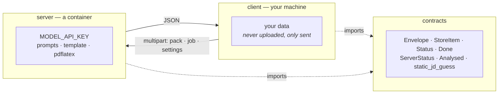
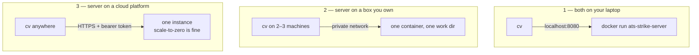

# Running the two halves apart

ats-strike is deliberately two programs. This page is about where to put each
one, and what the boundary buys you.

## Why they are separate

| | Client | Server |
|---|---|---|
| Holds | your profile, contact data, template, images, the output tree | the provider API key, the prompts, the LaTeX toolchain |
| Costs to install | one file | ~780 MB of TeX Live |
| Wants to be | on the machine you copy postings on | wherever compute is cheap and always on |
| Scales by | being copied | being given more RAM and CPU |

Splitting along that line is what makes each half simple:

- **The key never leaves the server.** A client needs no provider account and
  no `.env`; the one secret it can hold is a bearer token for your own server.
- **Your data never rests on the server.** The profile, the contact details,
  the preferences and the images arrive with each request and are thrown away
  when it ends. There is no database, no accounts, nothing to breach beyond
  the requests currently in flight.
- **Nobody installs LaTeX.** The toolchain, its fonts and its failure modes
  live in one image you did not have to reproduce on Windows.
- **Each half changes on its own.** The wire format is a third package both
  import; `tests/test_architecture.py` fails the build if either side imports
  the other. A new client mode touches no server code, and a new model role,
  prompt, step or setting touches no client code: the client sends a server
  folder's files and its `[settings]` without reading them.
- **One client, several servers.** The protocol knows no pipeline, so the same
  client talks to a 0.5, a 1.x and a 2.0 server — side by side on one posting,
  each from its own server folder.



## Where to run each



**1 — Both local.** The default. `docker run -p 8080:8080` and
`url = "http://localhost:8080"` in the server's `cv.toml` section. No token needed: nothing but your own
machine can reach it. This is also the cheapest way to try a different model —
the container restarts in a second.

**2 — Server on a machine you own.** A NAS, a home server, a spare box. Set
`ATS_API_TOKEN` even here: without it, anyone on the network can spend
your provider credit. Point every client at it with `url` in its
`cv.toml` server section.

**3 — Server on a cloud platform.** Works as-is: the image runs as any uid,
needs no volume, tolerates a read-only root filesystem, and answers `/healthz`
for the platform probe without a token. Three things to get right:

- **Set `ATS_API_TOKEN` and put TLS in front.** The client sends your
  profile and your contact details in the request body.
- **One instance per `ATS_WORK_DIR`, and `WEB_CONCURRENCY=1`.** A running
  CV job lives in the process that started it, and a starting process closes
  every session it finds unfinished.
- **Scale-to-zero is fine, autoscaling is not.** The client knocks on
  `/healthz` three times before its first real call, so a cold start is
  handled — but a stream that lands on another instance than the job's only
  sees the job if the work root is shared, and never sees it finish if that
  instance is new.
- **Give the work root a home that outlives the instance** — a volume, or a
  bucket mounted as a folder — and a session survives the instance being
  recycled: the client gets its CV back by running the posting again.
  `server/terraform` mounts an OSS bucket on Alibaba Cloud. A platform that
  only gives CPU during requests (Cloud Run's default) stalls a job whenever no
  stream is open: give it CPU for the whole instance instead.

## What the client needs to know

A `[servers.<name>]` section of `cv.toml` says it, and only `folder` and `url`
are required:

```toml
[servers.v11]
folder  = "v11"            # the files this server is sent
url     = "https://ats-strike.example.run.app"
token   = "the-bearer-token"
timeout = 1800             # how long to follow one CV job

[servers.v11.settings]     # forwarded untouched; its meaning is the server's
pages = 2
```

That, and the protocol number `/healthz` reports, is the entire coupling.
Everything else the client sends is content. To run a second server version
beside the first, give it a section of its own in `cv.toml`
(see [the client guide](https://github.com/gcontini/ats-strike-client/blob/main/doc/client.md#several-servers)).

## Keeping the boundary honest

If you change either half, these are the rules that keep them separable — they
are also what the two repositories' test suites check:

- `client → contracts ← server → pipeline`. The client and the server never
  import each other; the pipeline imports none of the others, and the server
  only its top level.
- The contracts package imports pydantic and nothing else. It is loaded by a
  web server *and* by a frozen executable, and has to stay cheap in both.
- No server-side dependency reaches the client: no `openai`, no `jinja2`, no
  `pypdf`, no `fastapi`. `subprocess` is allowed in exactly one file — the
  clipboard helper probe.
- Anything new on the wire goes in `contracts/`, not in a client-side model
  that happens to match — and nothing pipeline-specific goes on the wire at
  all: a new step, artifact or setting is a file to store or a key in
  `[settings]`.

## Four repositories

The two halves are separate repositories, each with its own version and its
own release:

| Repository | Holds | Releases |
|---|---|---|
| [ats-strike](https://github.com/gcontini/ats-strike) | the server, the pipeline, this site | the container image and the site, at the server's version |
| [ats-strike-client](https://github.com/gcontini/ats-strike-client) | the CLI | both executables and a data folder, at the client's version |
| [ats-strike-contract](https://github.com/gcontini/ats-strike-contract) | the wire format, `cv_contracts` | nothing: the others check it out as a git submodule at `contracts/`, the 0.5 line too |
| [ats-integration-tests](https://github.com/gcontini/ats-integration-tests) | the other three as submodules, and the tests that need the client and the server together | nothing |

A client talks to any server that speaks the same protocol number, which
`/healthz` reports, so the two need not move in step. A wire change travels
as a commit in the contract repository, then the new submodule pointer in the
server and in the client, then the new pointers in ats-integration-tests:
its `tests/test_integration.py` drives the real client against two real
server apps in-process, and its CI renders a PDF with the built executable
through a running server. That last step is what proves the two halves still
agree.
