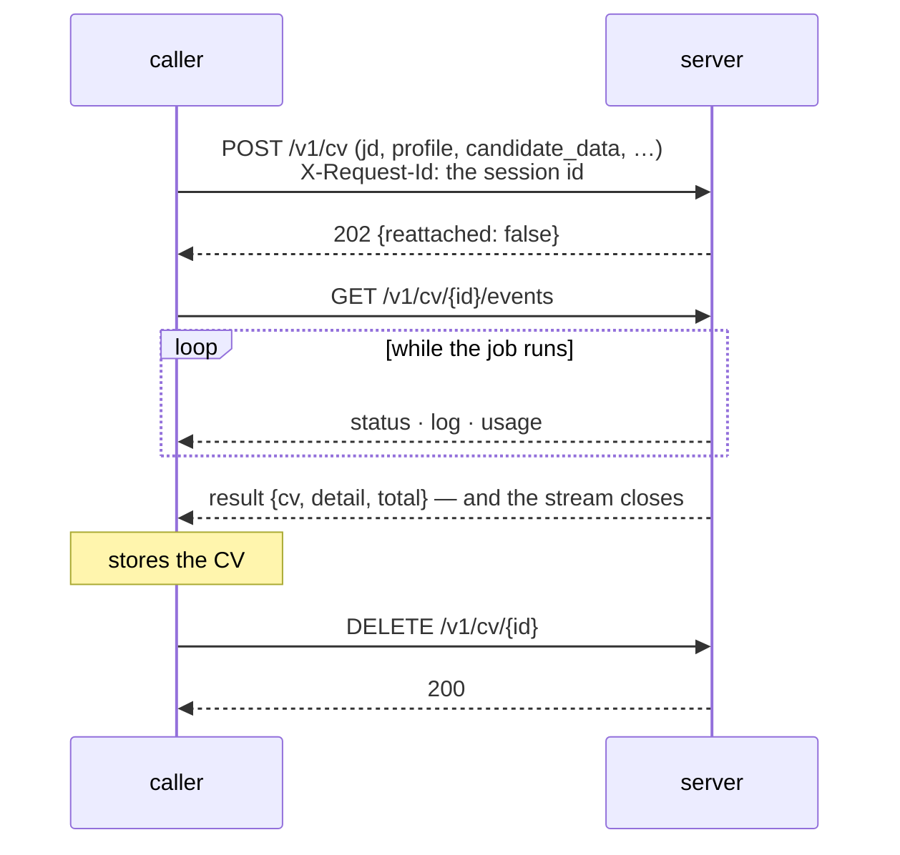

# The HTTP API

Everything is `multipart/form-data` in and JSON out. There is no database and
no accounts: every request carries what it needs. The one thing the server
keeps is a CV job's session — the events it streams — until the client says it
has everything, or until it is older than `RESUMIX_SESSION_TTL_DAYS`.

Base URL is wherever you run it — `http://localhost:8080` by default. The
interactive OpenAPI page FastAPI generates is at `/docs`.

## Conventions

**Parts.** Every text part can be sent as a file (`-F jd=@JD.txt`) or as a
plain field (`-F jd_text=...`); the file wins if you send both. JSON parts
(`candidate_profile`, `candidate_data`, `document`, `analysis`) must be files,
must parse, and must be JSON *objects*. A UTF-8 BOM is stripped. Any single
part over `RESUMIX_MAX_PART_BYTES` (2 MB) is refused with `413` before it is
read.

**Images.** The `images` part is repeatable, at most 10 per request. Each
part's **file name** is the name the template includes it under — that is the
whole interface. Path components are stripped.

**Auth.** If `RESUMIX_API_TOKEN` is set, every `/v1/...` call must send
`Authorization: Bearer <token>`; `/healthz` stays open so a platform probe
works. With no token set, the server is open to anyone who
can reach it, which is only reasonable on a private network.

**The envelope.** Every response, success or failure, has the same shape:

```jsonc
{
  "request_id": "b510f8dff047",   // also in the X-Request-Id header
  "ok": true,
  "data": { },                    // the payload, when ok
  "error": null                   // one line, when not
}
```

Fields that are null are omitted. Nothing else rides on a reply. What the
server *did* — every line it logged, every model call and its cost — is
streamed by a CV job as events; for any other request it is in the server's
own log, under the request id.

**Request ids.** The server generates a 12-hex-character id per request and
echoes it in the `X-Request-Id` header. An inbound `X-Request-Id` is honoured
if it matches `[A-Za-z0-9_-]{1,64}`. For `POST /v1/cv` it is the session's id,
and names its directory under the work root, so anything else would be a way
to write where the server was not asked to.

## Endpoints at a glance

| Method | Path | Auth | Costs | Returns |
|---|---|---|---|---|
| `GET` | `/healthz` | no | nothing | `ServerStatus` |
| `POST` | `/v1/jd/detect` | yes | 0–1 small model call | `JDDetection` |
| `POST` | `/v1/jd/analysis` | yes | 1 small model call | `JDAnalysis` |
| `POST` | `/v1/cv` | yes | minutes of model calls, or nothing for a session already there | `202` + `CVSession` |
| `GET` | `/v1/cv/{id}/events` | yes | nothing | server-sent events |
| `DELETE` | `/v1/cv/{id}` | yes | nothing | `200`, no data |
| `DELETE` | `/v1/cv?all` | yes | nothing | `Cleanup` |
| `POST` | `/v1/cv/render` | yes | one `pdflatex` run | `RenderedCV` |
| `POST` | `/v1/letter` | yes | 1 small model call | `CoverLetter` |

---

## `GET /healthz`

No auth. What this server is and whether it can do its job.

```jsonc
{"request_id": "…", "ok": true, "data": {
  "status": "ok",                 // "degraded" when pdflatex is missing
  "version": "0.2.0",
  "pdflatex": true,
  "models": {"detect": "qwen3.8-flash", "analysis": "qwen3.8-flash",
             "letter": "qwen3.8-flash", "cv": "qwen3.8-max", "review": "qwen3.8-max",
             "highlight": "qwen3.8-flash"},
  "auth_required": false
}}
```

## `POST /v1/jd/detect`

Is this text a job posting?

```bash
curl -F jd=@JD.txt localhost:8080/v1/jd/detect
```

| Part | | |
|---|---|---|
| `jd` / `jd_text` | required | The text to check |

Structural checks run first — length band (`RESUMIX_JD_MIN_CHARS` …
`_MAX_CHARS`, 500–30000 by default), no binary payload — and only if they
pass does it cost one small model call. The answer is
`{"is_job_description": true|false}`; why it was rejected is in the request's
log, not in the reply. The same structural check ships in
`resumix_contracts.static_jd_guess`, so a client can run it before spending
the call at all.

## `POST /v1/jd/analysis`

Scores a posting against your profile and extracts its facts.

```bash
curl -F jd=@JD.txt \
     -F candidate_profile=@candidate_profile.json \
     -F pers_preferences=@candidate_preferences.md \
     localhost:8080/v1/jd/analysis
```

| Part | | |
|---|---|---|
| `jd` / `jd_text` | required | The posting |
| `candidate_profile` | required | JSON object: everything you have done |
| `pers_preferences` / `pers_preferences_text` | required | What you want from a job, in prose |
| `sys_prompt_analysis` | optional | Replace the analysis prompt |

Returns a `JDAnalysis`:

| Field | Type | |
|---|---|---|
| `match_percentage` | int | 0–100, how well the posting fits the profile |
| `match_rationale` | str? | One line saying why |
| `job_title` | str | As extracted from the posting |
| `work_location` | str? | e.g. `"Milan, Italy"` |
| `work_mode` | str | `full_remote` \| `hybrid` \| `on_site` \| `not_specified` |
| `expected_salary` | str? | As stated, e.g. `"EUR 60k-80k"` |
| `max_salary` | int | Upper bound, or `-1` if not found |
| `salary_match` | bool? | Whether the JD's salary meets your preferences; `null` if the JD states none |
| `hard_skills`, `soft_skills` | str[] | Up to 4 each |
| `company_name` | str | The employer, or the agency |
| `posting_url` | str? | If the posting text carries one |
| `gaps` | str | Where you fall short of the posting |
| `pers_preferences` | str | How the posting reads against your preferences |
| `pers_preference_score` | float | The summed score of the preferences it satisfies |
| `should_apply` | str | `NO` (skip) \| `CHECK` (human check) \| `YES` (apply) — per the `should_apply` rules in your preferences, else `salary_match` |
| `should_apply_reason` | str | Why should apply |
| `company_evaluation` | str? | Only for `CHECK`: what online reviews (Trustpilot, Glassdoor) say about the hiring company |

## `POST /v1/cv` → `GET /v1/cv/{id}/events` → `DELETE /v1/cv/{id}`

The expensive one: minutes of model calls. It does not wait. It starts the job
as a **session**, which the caller follows as a stream of server-sent events
and lets go of once it has stored the CV.



```bash
ID=$(sha256sum JD.txt | cut -c1-64)
curl -s -H "X-Request-Id: $ID" -F jd=@JD.txt \
     -F candidate_profile=@candidate_profile.json \
     -F candidate_data=@candidate_data.json localhost:8080/v1/cv
curl -sN localhost:8080/v1/cv/$ID/events      # the job, to its last event
curl -s -X DELETE localhost:8080/v1/cv/$ID    # once the CV is saved
```

### `POST /v1/cv`

| Part | | |
|---|---|---|
| `jd` / `jd_text` | required | The posting |
| `candidate_profile` | required | JSON object — what the model tailors from |
| `candidate_data` | required | JSON object — what the template prints |
| `sys_prompt_cv`, `sys_prompt_highlight`, `sys_prompt_review` | optional | Replace a prompt for this request |
| `template` | optional | Replace `resume.tex.jinja`, page checks included |
| `images` | optional | Repeatable, ≤10. Each part's file name is the name the template includes it under. |
| `temperature` | optional | Sampling temperature for the CV model only; the review and highlight models keep theirs |
| `presence_penalty` | optional | Presence penalty for the CV model only, likewise |
| `pages` | optional | Page limit the CV must fit. Default 2, minimum 1. |

Answers `202` with `{"request_id": "<id>", "ok": true, "data": {"reattached":
false}}`.

**The session id is the caller's.** Send it as `X-Request-Id`. The client
uses the SHA-256 of the posting's text, so running the same posting again finds
the session it already has, and a client that died, or lost its connection,
loses nothing it paid for. When the id already has a session, nothing is
started — no slot is claimed either — and the answer says `"reattached":
true`: follow its events as for a new one. Sessions whose last event is older
than `RESUMIX_SESSION_TTL_DAYS` (1 by default) are deleted first, so an old one
is not found. With no `X-Request-Id`, the server picks an id and every POST is
a new job. `429 too_many_jobs` applies to a new job only.

**Why `candidate_data` is required.** The page limit is enforced by actually
compiling the CV and counting the pages, so the instruction fed back to the
model is grounded in a real overflow. A page count taken with the contact
block missing is not the page count of the CV you will send. No model is shown
`candidate_data`: it goes to the renderer and nowhere else.

### `GET /v1/cv/{id}/events`

`text/event-stream`. Every event the session has — from the first, or from the
one after `Last-Event-ID: n` — then each new one as the job writes it, until
the last, after which the stream closes. A `: ping` line every 15 quiet seconds
keeps the connection open through a long model call. The session is files, so
a stream can be opened as often as you like, while the job runs or long after,
and a dropped one loses nothing: reconnect with the last `id:` you got.

```text
id: 1
event: status
data: {"status": "generate", "detail": ""}

id: 2
event: log
data: {"ts": "2026-01-15T09:30:53Z", "level": "INFO", "stage": "cv.generate", "message": "  ⏱ [cv] qwen3.8-max 41.2s | input=7104, thinking=610, output=1832, …"}

id: 3
event: usage
data: {"role": "cv", "model": "qwen3.8-max", "seconds": 41.2, "input_tokens": 7104, "thinking_tokens": 610, "output_tokens": 1832}

id: 42
event: result
data: {"cv": {"document": {…}, "tex": "\\documentclass…", "pdf_base64": "JVBERi0…"}, "detail": "done, 6 model calls, …", "total": {"calls": 6, "seconds": 312.4, …}}
```

| Event | Payload | When |
|---|---|---|
| `status` | `CVStatus`: `status`, `detail` | Each step: `generate`, `review`, `re-generate`, `page_check`, `highlight` |
| `log` | `LogEntry`: `ts`, `level`, `stage`, `message` | Every line the server logged for the job (at most 2000) |
| `usage` | `ModelCall`: `role`, `model`, `seconds`, `input_tokens`, `thinking_tokens`, `output_tokens` | After every model call, failed attempts included |
| `result` | `CVResult`: `cv`, `detail`, `total` | The job is done: the last event |
| `error` | `CVFailure`: `http_status`, `error`, `total` | The job failed: the last event |

`detail` is written for a person and may span several lines — a rejected
review quotes the reviewer's complaints verbatim, and a failed page check
quotes the condense instruction verbatim, because those are the words the
model is about to be given. `total` adds up every model call of the run, so a
failed job still says what it cost.

**A failed job reports itself here**, with the status its cause maps to
(`502`, `504`, `422`) and the cause in the same form as any other error. A job
the server restarted under ends with `503 unavailable`. See
[the CV pipeline](cv-pipeline.md) for what each step does.

`cv.document` is one flat object — what the model wrote with your
`candidate_data` merged over the top, so a field the model invents can never
replace a real contact detail. It has no schema: what the template reads from
it is between you and the template. Store it, edit it, post it back to
`/v1/cv/render`.

`404 unknown_request` means there is no session by that id: it was
acknowledged, it is older than the server keeps sessions, or it never started.

### `DELETE /v1/cv/{id}`

Acknowledge: the caller has everything, and the server deletes the session.
Do it once the CV is stored, not before — until then the session is what lets
a caller that died get its CV back for nothing. `409 job_not_ready` while the
job runs: its worker is still writing there, and a new session for the same
posting would be the same directory. `404` when there is no such session.

### `DELETE /v1/cv?all`

Deletes every session whose job is not running, and answers
`{"deleted": 3, "running": 1}`. Without `all` it is a `400`: not something to
do by accident.

## `POST /v1/cv/render`

```bash
curl -F document=@cv.json     localhost:8080/v1/cv/render
curl -F tex=@cv_edited.tex    localhost:8080/v1/cv/render
```

| Part | | |
|---|---|---|
| `document` | one of the two | A CV document as JSON — a CV job's `cv.document`, or anything else your template can read |
| `tex` | one of the two | Ready LaTeX, compiled as-is |
| `template` | optional | Replace `resume.tex.jinja` |
| `images` | optional | Repeatable, ≤10 |

Sending both, or neither, is a `400`. Returns `{tex, pdf_base64}`; `document`
is not echoed back, because whoever asked for the render already has it.
Cheap and deterministic: editing the content and re-rendering never costs a
model call.

The rendered `.tex` is dated at render time, so re-rendering yesterday's
document dates it today.

## `POST /v1/letter`

```bash
curl -F jd=@JD.txt -F candidate_profile=@candidate_profile.json \
     -F candidate_data=@candidate_data.json \
     -F analysis=@analysis.json localhost:8080/v1/letter
```

| Part | | |
|---|---|---|
| `jd` / `jd_text` | required | The posting |
| `candidate_profile` | required | JSON object |
| `candidate_data` | required | JSON object — the header block's name, email, phone, LinkedIn |
| `analysis` | optional | A `JDAnalysis` — makes the letter more targeted, and enables the web research |
| `sys_prompt_letter` | optional | Replace the letter prompt |
| `temperature` | optional | Sampling temperature for the letter |
| `presence_penalty` | optional | Presence penalty for the letter |

Returns `{"text": "…", "words": 312}`, validated between 180 and 450 words.
When the analysis names the employer *and* the
endpoint supports server-side web search, the model is told to research the
company; an endpoint that rejects the flag falls back to writing without it.

---

## Errors

A failed request returns the same envelope with `ok: false` and one line
saying what went wrong, its kind and its stage — one line, except that a
failed compile adds the end of the TeX log on the lines after it, because only
the TeX log says where the document breaks:

```json
{"request_id": "b510f8dff047", "ok": false,
 "error": "model_output [cv.generate]: No CV passed review in 4 attempts."}
```

| Status | Kind | Means |
|---|---|---|
| `400` | `bad_request`, `missing_part`, `bad_part` | A required part is absent, empty, not UTF-8, not JSON, not an object, or mutually exclusive parts were both sent |
| `401` | `unauthorized` | `RESUMIX_API_TOKEN` is set and the request had no matching token. Answers with `WWW-Authenticate: Bearer` |
| `404` | `unknown_request` | No CV session by that id: acknowledged, older than the server keeps sessions, or never started |
| `409` | `job_not_ready` | The CV job is still running, so its session cannot be acknowledged yet |
| `413` | `part_too_large` | A part exceeded `RESUMIX_MAX_PART_BYTES` |
| `422` | `latex_compile` | The template or the `.tex` does not compile. The end of the TeX log follows the error line |
| `422` | `validation_error` | An uploaded document does not match the expected schema |
| `429` | `too_many_jobs` | All job slots are busy. Answers with `Retry-After: 30` |
| `502` | `model_output` | The model never produced usable output within the attempts allowed |
| `502` | `provider_error`, `provider_unreachable` | The model endpoint failed. The body is never echoed — it can carry the endpoint and the key |
| `504` | `latex_timeout`, `budget_exceeded`, `provider_timeout` | A compile, the whole run, or the provider hit its timeout |
| `500` | `internal_error` | A bug here. Everything else above is an answer, not a crash |

The stage in brackets (`[cv.generate]`, `[compile]`, `[render]`) says where in
the pipeline it happened. For a CV job, the attempts that led there — every
failed one included, with its token cost — are in the session's `log` and
`usage` events. For any other request, the server's own log (stdout) has every
line under the request id.

## The wire format as a package

`resumix_contracts` is the same set of pydantic models the server answers
with, published as its own package so a client can import it instead of
hand-rolling the shapes:

```python
from resumix_contracts import (
    Envelope, CVStatus, RenderedCV, CoverLetter, ServerStatus,
    JDAnalysis, JDDetection, LogEntry, static_jd_guess,
    EVENT_PAYLOADS, CVResult, CVFailure, CVSession, ModelCall, TokenUsage,
)

envelope = Envelope[RenderedCV].model_validate(response.json())
pdf_bytes = envelope.data.pdf_bytes()          # decodes pdf_base64

result = EVENT_PAYLOADS["result"].model_validate_json(data)   # a result event's data
```

It depends on pydantic and nothing else. The CV document itself deliberately
has no model there: it is whatever the CV model wrote merged with whatever
your `candidate_data.json` holds, and only your LaTeX template has an opinion
about it.
