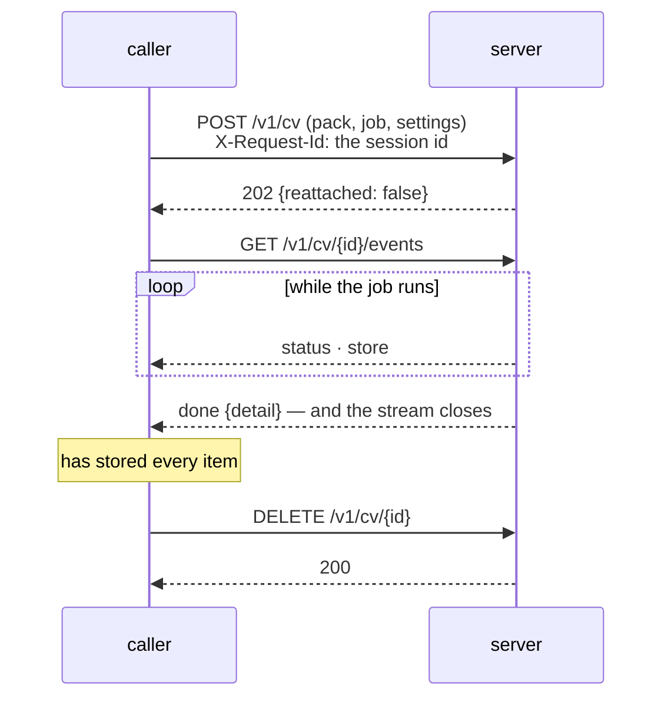

# The HTTP API (protocol 2)

Everything is `multipart/form-data` in and JSON out. There is no database and
no accounts: every request carries what it needs. The one thing the server
keeps is a CV job's session — the events it streams — until the client says it
has everything, or until it is older than `ATS_SESSION_TTL_DAYS`.

The protocol knows no pipeline. A client sends a **pack** of files and stores
what the server tells it to store; it never needs to know a prompt's name, a
model role, a step or the analysis schema. That is what lets one client talk
to a 0.5, a 1.x and a 2.0 server, side by side, on the same posting.

Base URL is wherever you run it — `http://localhost:8080` by default. The
interactive OpenAPI page FastAPI generates is at `/docs`.

## Conventions

**Three parts, on every pipeline request.**

| Part | Kind | Holds |
|---|---|---|
| `pack` | file, repeatable | Every file of the client's server folder except `server.toml`, sub-folders included. The part's **file name** is the path relative to the server folder, with `/` (`candidate_profile.json`, `cache/pool.json`). |
| `job` | file, repeatable | The posting as this server sees it: `jd.txt`, `analysis.json`, and the files this server stored for the job before (`cv.json`, `cv.tex`, `steps/...`), named relative to its subfolder. A bare posting is a job with only `jd.txt`. |
| `settings` | form field | A JSON object: the `[settings]` table of the client's `server.toml`, forwarded untouched. Absent means `{}`. |

What the files and settings mean is the pipeline's business (see
[the 1.x mapping](#the-1x-pipelines-files-and-settings)). The server only
checks that they are what a request may carry, before any work: a name must be
relative — no leading `/`, no `..` part, no backslash, not empty — else `400
bad_part`; more than 200 files in `pack` and `job` together is a `400` before
anything is read; any one file over `ATS_MAX_PART_BYTES` (2 MB) is a `413`;
`settings` that is not a JSON object is a `400`. A repeated name: the last one
wins.

**Auth.** If `ATS_API_TOKEN` is set, every `/v1/...` call must send
`Authorization: Bearer <token>`; `/healthz` stays open so a platform probe
works. With no token set, the server is open to anyone who can reach it, which
is only reasonable on a private network.

**The envelope.** Every response, success or failure, has the same shape:

```jsonc
{
  "request_id": "b510f8dff047",   // also in the X-Request-Id header
  "ok": true,
  "data": { },                    // the payload, when ok
  "error": null                   // one line, when not
}
```

Fields that are null are omitted.

**Request ids.** The server generates a 12-hex-character id per request and
echoes it in the `X-Request-Id` header. An inbound `X-Request-Id` is honoured
if it matches `[A-Za-z0-9_-]{1,64}`. For `POST /v1/cv` it is the session's id,
and names its directory under the work root, so anything else would be a way
to write where the server was not asked to.

**The protocol number.** `/healthz` reports `"protocol": 2`. A server that
reports none is protocol 1, and the client refuses any number but its own.

## A thing to store

What a server wants kept travels as one shape, whether as a CV job's `store`
event or as an element of a REST reply's `items`:

```jsonc
{"location": "CV",                 // CV: the job folder | CACHE: <server folder>/cache
 "type": "step",                   // log: append a line | step: write a file | cv: the final PDF
 "name": "steps/key_points.json",  // relative path; empty for a log
 "text": "..."}                    // UTF-8 content — or "base64": "..." for binary (the PDF)
```

`location` and `type` are plain strings: a client skips a location, a type or
an event name it does not know, so a server can add one without breaking an
older client. Where the ats-strike client puts each one is in
[the client guide](client.md#job-folders).

A **log** item's text is `<ts ISO-8601 seconds, UTC> <LEVEL padded to 7>
[<stage>] <message>`, location `CV`. Token usage is a log line too: the server
appends one

```text
2026-11-13T09:46:12+00:00 INFO    [run] Σ 21 model call(s), 961.4s | input=48211, thinking=30117, output=9822
```

as the last log item before a CV job's `done` or `error`, and as the last item
of a REST reply when the request made at least one model call.

## Endpoints at a glance

| Method | Path | Auth | Costs | `data` |
|---|---|---|---|---|
| `GET` | `/healthz` | no | nothing | `ServerStatus` |
| `POST` | `/v1/jd/detect` | yes | 0–1 small model call | `Detection` |
| `POST` | `/v1/jd/analysis` | yes | 1 small model call | `Analysed` |
| `POST` | `/v1/cv` | yes | minutes of model calls, a render, or nothing for a session already there | `202` + `CVSession` |
| `GET` | `/v1/cv/{id}/events` | yes | nothing | server-sent events |
| `DELETE` | `/v1/cv/{id}` | yes | nothing | `200`, no data |
| `DELETE` | `/v1/cv?all` | yes | nothing | `Cleanup` |
| `POST` | `/v1/cv/render` | yes | one `pdflatex` run | `Rendered` |
| `POST` | `/v1/letter` | yes | 1 small model call | `Letter` |

---

## `GET /healthz`

No auth. What this server is, which protocol it speaks, and whether it can do
its job.

```jsonc
{"request_id": "…", "ok": true, "data": {
  "status": "ok",                 // "degraded" when pdflatex is missing
  "version": "1.1.0",
  "protocol": 2,
  "pdflatex": true,
  "models": {"detect": "deepseek-v4.1-flash", "analysis": "qwen3.8-flash",
             "letter": "qwen3.8-flash", "cv": "gpt-6.1-terra", "…": "…"},
  "auth_required": false
}}
```

## `POST /v1/jd/detect`

Is the job's `jd.txt` a job posting?

```bash
curl -F job=@JD.txt\;filename=jd.txt localhost:8080/v1/jd/detect
```

Structural checks run first — length band (`ATS_JD_MIN_CHARS` …
`_MAX_CHARS`, 500–30000 by default), no binary payload — and only if they
pass does it cost one small model call. The answer is
`{"is_job_description": true|false}`; why is in the request's log, not in the
reply. The same structural check ships in `cv_contracts.static_jd_guess`, so a
client can run it before spending the call at all. No `jd.txt` is a `400
missing_part`; `pack` and `settings` are ignored.

## `POST /v1/jd/analysis`

Scores a posting against the candidate in the pack and extracts its facts.

```bash
curl -F job=@JD.txt\;filename=jd.txt \
     -F pack=@candidate_profile.json -F pack=@candidate_preferences.md \
     localhost:8080/v1/jd/analysis
```

Answers `{"analysis": {…}, "items": [...]}`. `analysis` is an opaque JSON
object, as the server's pipeline wrote it — each server version has its own
schema. A client needs only `job_title`, `company_name` and `should_apply`
(`NO` | `CHECK` | `YES`) from it, and should keep the rest as it came. `items`
are the request's log lines, the `Σ` line last.

## `POST /v1/cv` → `GET /v1/cv/{id}/events` → `DELETE /v1/cv/{id}`

The expensive one. It does not wait: it starts the job as a **session**,
which the caller follows as a stream of server-sent events and lets go of once
it has stored everything.



```bash
ID=$(sha256sum JD.txt | cut -c1-64)
curl -s -H "X-Request-Id: $ID" -F job=@JD.txt\;filename=jd.txt \
     -F pack=@candidate_profile.json -F pack=@candidate_data.json \
     -F settings='{"pages": 2}' localhost:8080/v1/cv
curl -sN localhost:8080/v1/cv/$ID/events      # the job, to its last event
curl -s -X DELETE localhost:8080/v1/cv/$ID    # once everything is stored
```

### `POST /v1/cv`

What a CV request does is decided by the job, the same way on every server
version:

1. the job holds `cv.json` → it is rendered (the document wins over the tex);
2. else it holds `cv.tex` → it is compiled as it stands;
3. else the CV is written from `jd.txt`.

There is no step-level resume: a job that holds only `steps/...` is written
again. A **written** CV stores `step` `cv.json` (the merged document,
`indent=2`, `ensure_ascii=False`), `step` `cv.tex`, and `cv` `cv.pdf`; the 1.x
pipeline also stores each intermediate result as `step` `steps/<name>.json`
as it is ready. A **rendered** document stores `step` `cv.tex` and `cv`
`cv.pdf`; a **compiled** tex stores `cv` `cv.pdf` only. No pipeline stores a
`CACHE` item yet.

Answers `202` with `{"request_id": "<id>", "ok": true, "data": {"reattached":
false}}`.

**The session id is the caller's.** Send it as `X-Request-Id`. The client
uses the SHA-256 of the job's `jd.txt`, so running the same posting again
finds the session it already has, and a client that died, or lost its
connection, loses nothing it paid for. When the id already has a session,
nothing is started — no slot is claimed either — and the answer says
`"reattached": true`: follow its events as for a new one. Sessions whose last
event is older than `ATS_SESSION_TTL_DAYS` (1 by default) are deleted first,
so an old one is not found. With no `X-Request-Id`, the server picks an id and
every POST is a new job. `429 too_many_jobs` applies to a new job only.

A pack problem the job finds once it runs — a missing `candidate_data.json`,
say — ends the session with an `error` event carrying `400`, not a synchronous
`400`.

### `GET /v1/cv/{id}/events`

`text/event-stream`. Every event the session has — from the first, or from the
one after `Last-Event-ID: n` — then each new one as the job writes it, until
the last, after which the stream closes. A `: ping` line every 15 quiet seconds
keeps the connection open through a long model call. The session is files, so
a stream can be opened as often as you like, while the job runs or long after,
and a dropped one loses nothing: reconnect with the last `id:` you got.

```text
id: 1
event: status
data: {"status": "started", "detail": ""}

id: 2
event: status
data: {"status": "jd_evaluation", "detail": ""}

id: 3
event: store
data: {"location": "CV", "type": "log", "name": "", "text": "2026-11-13T09:30:53+00:00 INFO    [cv.jd_evaluation]   ⏱ [jd_evaluation] deepseek-flash 21.2s | input=1847, thinking=7256, output=832"}

id: 4
event: store
data: {"location": "CV", "type": "step", "name": "steps/key_points.json", "text": "[\n  {\n    \"id\": 1, …"}

id: 5
event: status
data: {"status": "profile_scoring", "detail": "11 key points, tokens used=9935, thinking=7256, elapsed=21.3s"}

id: 96
event: store
data: {"location": "CV", "type": "cv", "name": "cv.pdf", "base64": "JVBERi0…"}

id: 97
event: store
data: {"location": "CV", "type": "log", "name": "", "text": "… INFO    [run] Σ 21 model call(s), 961.4s | input=…, thinking=…, output=…"}

id: 98
event: done
data: {"detail": "done, 21 model calls, 2 page(s)"}
```

| Event | Payload | Notes |
|---|---|---|
| `status` | `Status`: `status` (free text), `detail` | Shown, never stored. The first event of every session is `status: "started"`. An identical consecutive status is not repeated. |
| `store` | `StoreItem` | Each step result as it is ready, each log line as it is logged, then the CV. |
| `done` | `Done`: `detail` | The last event. `detail` is the pipeline's one-line summary. |
| `error` | `Failure`: `http_status`, `error` | The last event. |

`status` and `detail` are written for a person, in the pipeline's own words.
**A failed job reports itself here**, with the status its cause maps to
(`400`, `422`, `502`, `504`) and the cause in the same form as any other error;
the `Σ` line before it still says what the run cost. A job the server
restarted under ends with `503 unavailable`. See
[the CV pipeline](cv-pipeline.md) for what each 1.x step does.

`404 unknown_request` means there is no session by that id: it was
acknowledged, it is older than the server keeps sessions, or it never started.

### `DELETE /v1/cv/{id}`

Acknowledge: the caller has everything, and the server deletes the session.
Do it once every item is stored, not before — until then the session is what
lets a caller that died get its CV back for nothing. `409 job_not_ready` while
the job runs: its worker is still writing there, and a new session for the
same posting would be the same directory. `404` when there is no such session.

### `DELETE /v1/cv?all`

Deletes every session whose job is not running, and answers
`{"deleted": 3, "running": 1}`. Without `all` it is a `400`: not something to
do by accident.

## `POST /v1/cv/render`

The CV request minus the writing: the job's `cv.json` rendered, or its
`cv.tex` compiled, with the pack's template and images. With neither file it
is a `400 missing_part`; with both, the document wins.

```bash
curl -F job=@cv.json -F pack=@resume.tex.jinja localhost:8080/v1/cv/render
curl -F job=@cv_edited.tex\;filename=cv.tex     localhost:8080/v1/cv/render
```

Answers `{"items": [...]}`: the same items a CV request would store. Cheap
and deterministic: editing the content and rendering again never costs a model
call. The rendered `.tex` is dated at render time, so rendering yesterday's
document dates it today.

## `POST /v1/letter`

```bash
curl -F job=@JD.txt\;filename=jd.txt -F job=@analysis.json \
     -F pack=@candidate_profile.json -F pack=@candidate_data.json \
     localhost:8080/v1/letter
```

Answers `{"text": "…", "items": [...]}`. The job's `analysis.json` is
optional and makes the letter more targeted (on 1.x it also enables the web
research when the endpoint supports it).

---

## The 1.x pipeline's files and settings

What the 1.x pipeline reads from a request; anything it does not name is
ignored, `cache/` included. A 0.5 server reads its own set.

| Pack file | Becomes |
|---|---|
| `candidate_profile.json` | the candidate's profile (JSON object). Needed by analysis, CV, letter. |
| `candidate_data.json` | what the template prints: name, contact details. Needed by CV and letter. No model is shown it. |
| `candidate_preferences.md` | your preferences. Needed by analysis. |
| `sys_prompt_analysis.txt` | the analysis prompt |
| `sys_prompt_<step>.txt` (`jd_evaluation`, `profile_scoring`, `format_selection`, `cv_body`, `cv_duties`, `validation_body`, `validation_duties`, `highlight`, `letter`, …) | that prompt |
| `cv_body_schema.json`, `cv_duties_schema.json` | the JSON schema the writer is shown |
| `resume.tex.jinja` | the template, page counts included |
| top-level `*.png`, `*.jpg`, `*.jpeg` | images, under their own file name, merged over the shipped ones |

Text is UTF-8 with a BOM stripped; a needed file that is missing is `400
missing_part`; one that is not UTF-8, not JSON or not a JSON object is `400
bad_part`. `jd.txt` is decoded with undecodable bytes replaced.

| Setting | Means |
|---|---|
| `pages` | Page limit the CV must fit: an integer of at least 1 (default 2), else `bad_part` |
| `extra_body` | Role → JSON object: that role's request settings for this request, replacing everything `models.toml` gives it. Each call takes only its own roles: analysis `analysis`; letter `letter`; CV `jd_evaluation`, `profile_scoring`, `format_selection`, `cv`, `duties`, `validation`, `highlight`. |

Unknown keys and roles are ignored.

## Errors

A failed request returns the same envelope with `ok: false` and one line
saying what went wrong, its kind and its stage — one line, except that a
failed compile adds the end of the TeX log on the lines after it, because only
the TeX log says where the document breaks:

```json
{"request_id": "b510f8dff047", "ok": false,
 "error": "model_output [cv.profile_scoring]: profile_scoring: no usable reply in 3 attempts:\n- it is not a JSON list"}
```

| Status | Kind | Means |
|---|---|---|
| `400` | `bad_request`, `missing_part`, `bad_part` | A needed file is absent, empty, not UTF-8, not JSON, not an object; a name is unusable; too many files; `settings` is not an object |
| `401` | `unauthorized` | `ATS_API_TOKEN` is set and the request had no matching token. Answers with `WWW-Authenticate: Bearer` |
| `404` | `unknown_request` | No CV session by that id: acknowledged, older than the server keeps sessions, or never started |
| `409` | `job_not_ready` | The CV job is still running, so its session cannot be acknowledged yet |
| `413` | `part_too_large` | A file exceeded `ATS_MAX_PART_BYTES` |
| `422` | `latex_compile` | The template or the `.tex` does not compile. The end of the TeX log follows the error line |
| `429` | `too_many_jobs` | All job slots are busy. Answers with `Retry-After: 30` |
| `502` | any other pipeline kind (`model_output`, `provider_error`, `provider_unreachable`, …) | The model never produced usable output, or its endpoint failed. An endpoint's body is never echoed — it can carry the endpoint and the key |
| `504` | `latex_timeout`, `budget_exceeded`, `provider_timeout` | A compile, the whole run, or the provider hit its timeout |
| `500` | `internal_error` | A bug here. Everything else above is an answer, not a crash |

The stage in brackets (`[cv.profile_scoring]`, `[compile]`, `[render]`) says
where in the pipeline it happened. For a CV job, the attempts that led there —
every failed one included, with its token cost — are in the session's log
items. For any other request, the reply's `items` carry its log lines; the
server's own log (stdout) has every line under the request id.

## The wire format as a package

`cv_contracts` is the same set of pydantic models the server answers with,
published as its own package so a client can import it instead of
hand-rolling the shapes:

```python
from cv_contracts import (
    PROTOCOL, Envelope, ServerStatus, Detection, Analysed, Rendered, Letter,
    EVENT_PAYLOADS, TERMINAL_EVENTS, StoreItem, Status, Done, Failure,
    CVSession, Cleanup, static_jd_guess,
)

envelope = Envelope[Rendered].model_validate(response.json())
pdf = next(i for i in envelope.data.items if i.type == "cv").content()   # bytes

item = EVENT_PAYLOADS["store"].model_validate_json(data)   # a store event's data
```

It depends on pydantic and nothing else, and knows no pipeline: no prompt
names, no model roles, no step names, no analysis schema.
